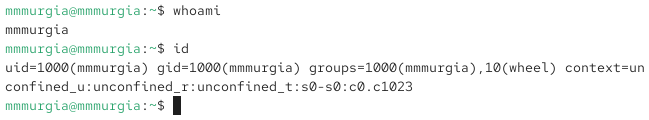
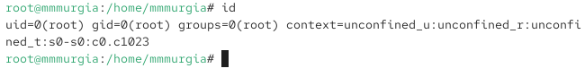
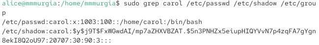

---
## Author
author:
  name: Мургия Марк Максимович
  degrees: DSc
  orcid: 0009-0006-9370-0808
  email: 1132243817@rudn.ru
  affiliation:
    - name: Российский университет дружбы народов
      country: Российская Федерация
      postal-code: 117198
      city: Москва
      address: ул. Миклухо-Маклая, д. 6
## Title
title: Лаб. раб. № 2
subtitle: Управление пользователями и группами
license: CC BY
date: today
date-format: "YYYY-MM-DD" # Example: 2025-09-06
---

## Докладчик

:::::::::::::: {.columns align=center}
::: {.column width="70%"}

  * Мургия Марк Максимович
  * Студент
  * НПИбд-02-25
  * Российский университет дружбы народов им. П. Лумумбы
  * [1132243817@rudn.ru](mailto:1132243817@rudn.ru)

:::
::: {.column width="30%"}

:::
::::::::::::::

## Цель и задачи

Выполнить действия по переключению между учётными записями пользователей, по управлению учётными записями пользователей.

Выполнить действия по созданию пользователей и управлению их учётными записями.

Выполнить действия по работе с группами пользователей.

## Переключение учётных записей пользователей

## Создание учётных записей пользователей

## Работа с группами

## Вывод

В результате лабораторной работы созданы пользователи alice, bob, carol, группы main, third и изучены методы управления учетными записями и группами пользователей.
