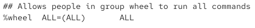
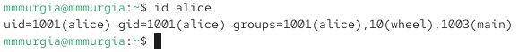
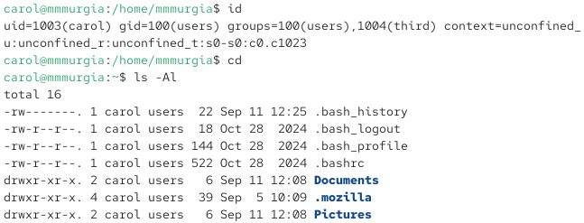
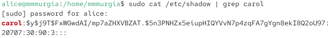
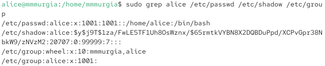
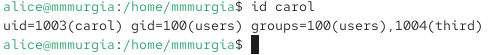
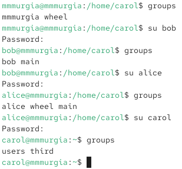

---
## Author
author:
  name: Мургия Марк Максимович
  degrees: DSc
  orcid: 0009-0006-9370-0808
  email: 1132243817@rudn.ru
  affiliation:
    - name: Российский университет дружбы народов
      country: Российская Федерация
      postal-code: 117198
      city: Москва
      address: ул. Миклухо-Маклая, д. 6

## Title
title: "Лабораторная работа №2"
subtitle: "Управление пользователями и группами"
license: "CC BY"
---

# Цель работы

Получить представление о работе с учётными записями пользователей и группами пользователей в операционной системе типа Linux.

# Задание

1. Ознакомиться с справочным описанием man по командам ls, whoami, id, su, passwd, vi, visudo, useradd, usermod, userdel, groupadd, groupdel.
2. Выполнить действия по переключению между учётными записями пользователей, по управлению учётными записями пользователей.
3. Выполнить действия по созданию пользователей и управлению их учётными записями.
4. Выполнить действия по работе с группами пользователей.

# Теоретическое введение

| Команды        | Функция                                                                                                      |
|----------------|--------------------------------------------------------------------------------------------------------------|
| `ls`           | Команда вывода содержимого каталогов и списка файлов                                                         |
| `whoami`       | Команда вывода текущего пользователя                                                                         |
| `id`           | Команда вывода числового идентификатора пользователя и группы                                                |
| `su`           | Команда переключения на другую учетную запись и запуска нового сеанса оболочки без выхода из текущей системы |
| `passwd`       | Команда назначения пароля пользователя                                                                       |
| `vi`           | Команда включения текстового редактора vi                                                                    |
| `visudo`       | Безопасное редактирования файла                                                                              |
| `useradd`      | Команда добавление пользователя                                                                              |
| `usermod`      | Команда редактирование пользователя                                                                          |
| `userdel`      | Команда удаления пользователя                                                                                |
| `groupadd`     | Команда создания группы                                                                                      |
| `groupdel`     | Команда удаления группы                                                                                      |

: Команды управления пользователями и группами {#tbl-std-dir}

# Выполнение лабораторной работы

## Переключение учётных записей пользователей

{#fig-001 width=70%}

Выведена информация: UID, GID, группы, в которые входит пользователь.

Вводим команду su для переключения к учётной записи root, пароль пользователя root, id

{#fig-002 width=70%}

Получена инфорация: уникальные UID, GID и группа. 

Вернулся к учётной записи своего пользователя:

su mmmurgia

sudo -i visudo – просмотр в безопасном режиме файла /etc/sudoers.

Мы используем visudo, потому что он проверяет структуру файла, перед тем как устанавливает изменения.

Убедился, что в открытом с помощью visudo файле присутствует строка %wheel ALL=(ALL) ALL.

{#fig-003 width=70%}

Эта строка означает, что все пользователи в группе wheel могут выполнять любые команды с разрешением sudo.

Пользователи группы wheel получают права администратора.

Создание пользователя alice в группе wheel:

sudo -i useradd -G wheel alice

Проверка, что пользователь alice добавлен в группу wheel

id alice

{#fig-004 width=70%}

Задать пароль для alice:

sudo -i passwd alice

Переключение на учётную запись alice:

su alice

Создание пользователя bob (пароль и проверка)

sudo useradd bob

sudo passwd bob

id bob

bob входит в следующие группы: bob.

## Создание учётных записей пользователей

Переключение на учётную запись root

su

Открыть файл конфигурации /etc/login.defs 

vim /etc/login.defs

Установил параметр:

USERGROUPS_ENAB no

Перешел в каталог /etc/skel:

cd /etc/skel

Создал каталоги Pictures и Documents:

mkdir Pictures

и

mkdir Documents

Изменил содержимое файла .bashrc, добавив строку.

export EDITOR=/usr/bin/vim

Переключиться на учётную запись alice:

su alice

Создание пользователя carol + пароль.

sudo -i useradd carol

sudo passwd carol

{#fig-005 width=70%}

Вводим команды:

su carol

id

cd

ls -Al

carol входит в первоначальную группу users.

Каталоги Pictures и Documents есть в домашнем каталоге.

Переключился на учётную запись alice:

su alice

sudo cat /etc/shadow | grep carol

{#fig-006 width=70%}

Показаны скрытые данные пароля carol.

Изменение свойства пароля carol.

sudo passwd -n 30 -w 3 -x 90 carol

В этой записи срок действия пароля истекает через 90 дней (-x 90). За три дня до истечения срока действия пользователь получит предупреждение (-w 3). Пароль должен использоваться как минимум за 30 дней (-n 30) до того, как его можно будет изменить.

Проверка данных о пароле пользователя carol в файле /etc/shadow:

sudo cat /etc/shadow | grep carol

Проверка, что идентификатор alice существует во всех трёх файлах:

grep alice /etc/passwd /etc/shadow /etc/group

{#fig-007 width=70%}

Проверка, что идентификатор carol существует не во всех трёх файлах:

sudo grep carol /etc/passwd /etc/shadow /etc/group

{#fig-008 width=70%}

## Работа с группами

Под учётной записью пользователя alice, созданы группы main и third:

sudo groupadd main

sudo groupadd third

Команда usermod для добавления пользователей alice и bob в группу main, а carol — в группу third:
sudo usermod -aG main alice

sudo usermod -aG main bob

sudo usermod -aG third carol

Проверка, что пользователь carol правильно добавлен в группу third:

id carol

{#fig-009 width=70%}

Пользователю carol назначена основная группа с идентификатором.

gid = 100 (users).

Пользователь входит во вторичные группы: third

Проверка, участниками каких групп являются другие созданные пользователи.

{#fig-010 width=70%}

alice и bob входят в группу main.

# Контрольные вопросы

1.	При помощи каких команд можно получить информацию о номере (идентификаторе), назначенном пользователю Linux, о группах, в которые включён пользователь? 
Ответ: id и groups
2.	Какой UID имеет пользователь root? При помощи какой команды можно узнать UID пользователя? Приведите примеры. 
Ответ: UID 0; id; id root
3.	В чём состоит различие между командами su и sudo? 
Ответ: Команда su переключает текущую сессию на другого пользователя (по умолчанию на root), а sudo выполняет одну конкретную команду с правами суперпользователя без полного переключения аккаунта
4.	В каком конфигурационном файле определяются параметры sudo? 
Ответ: /etc/sudoers
5.	Какую команду следует использовать для безопасного изменения конфигурации sudo? 
Ответ: visudo
6.	Если вы хотите предоставить пользователю доступ ко всем командам администрирования системы через sudo, членом какой группы он должен быть? 
Ответ: Пользователь должен быть членом группы sudo
7.	Какие файлы/каталоги можно использовать для определения параметров, которые будут использоваться при создании учётных записей пользователей? Приведите примеры настроек. 
Ответ: При создании новых учётных записей пользователей в операционных системах Linux параметры по умолчанию берутся из нескольких основных конфигурационных файлов и каталогов; /etc/default/useradd; /etc/login.defs; /etc/skel; /etc/adduser.conf
8.	Где хранится информация о первичной и дополнительных группах пользователей ОС типа Linux? В отчёте приведите пояснение таких записей для пользователя alice. 
Ответ: /etc/passwd; /etc/group; 
9.	Какие команды вы можете использовать для изменения информации о пароле пользователя (например о сроке действия пароля)?
Ответ: chage; passwd -l
10.	Какую команду следует использовать для прямого изменения информации в файле /etc/group и почему?
Ответ: groupmod, так как она безопасная

# Выводы

В результате лабораторной работы созданы пользователи alice, bob, carol, группы main, third и изучены методы управления учетными записями и группами пользователей.

# Список литературы{.unnumbered}

::: {#refs}
:::
