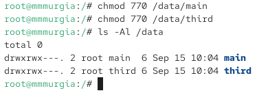
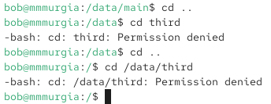
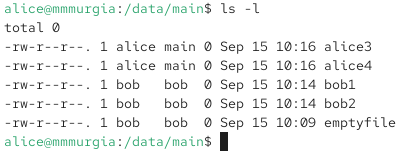
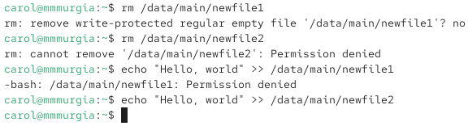

---
## Author
author:
  name: Мургия Марк Максимович
  degrees: DSc
  orcid: 0009-0006-9370-0808
  email: 1132243817@rudn.ru
  affiliation:
    - name: Российский университет дружбы народов
      country: Российская Федерация
      postal-code: 117198
      city: Москва
      address: ул. Миклухо-Маклая, д. 6
## Title
title: Лаб. раб. №3
subtitle: Настройка прав доступа
license: CC BY
date: today
date-format: "YYYY-MM-DD" # Example: 2025-09-06
---

## Докладчик

:::::::::::::: {.columns align=center}
::: {.column width="70%"}

  * Мургия Марк Максимович
  * Студент
  * НПИбд-02-25
  * Российский университет дружбы народов им. П. Лумумбы
  * [1132243817@rudn.ru](mailto:1132243817@rudn.ru)

:::
::: {.column width="30%"}

:::
::::::::::::::

## Цель и задачи

Получение навыков настройки базовых и специальных прав доступа для групп пользователей в операционной системе типа Linux.

1.	Прочитать справочное описание man по командам chgrp, chmod, getfacl, setfacl.
2.	Выполнить действия по управлению базовыми разрешениями для групп пользователей.
3.	Выполнить действия по управлению специальными разрешениями для групп пользователей.
4.	Выполнить действия по управлению расширенными разрешениями с использованием списков ACL для групп пользователей.

## Управление базовыми разрешениями

## Управление специальными разрешениями

## Управление расширенными разрешениями с использованием списков ACL

## Вывод

Для управления базовыми разрешениями используется команда chmod. Чтобы назначить специальные разрешения, нужно использовать бит идентификатора группы и sticky-bit. Пакеты ACL и setfacl используются для назначения расширенных разрешений.
