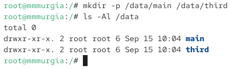
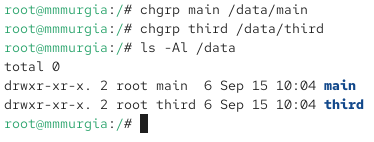
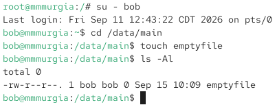
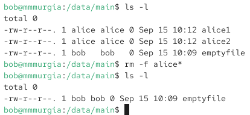
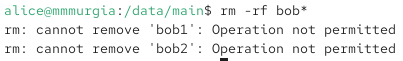
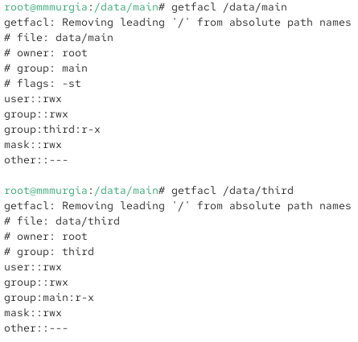
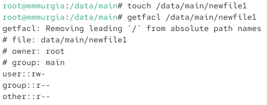
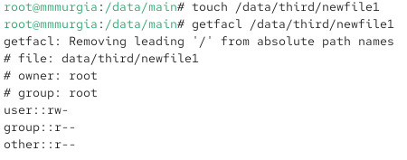
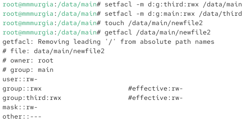

---
## Author
author:
  name: Мургия Марк Максимович
  degrees: DSc
  orcid: 0000-0002-0877-7063
  email: 1132243817@rudn.ru
  affiliation:
    - name: Российский университет дружбы народов
      country: Российская Федерация
      postal-code: 117198
      city: Москва
      address: ул. Миклухо-Маклая, д. 6

## Title
title: "Лабораторная работа №3"
subtitle: "Настройка прав доступа"
license: "CC BY"
---

# Цель работы

Получение навыков настройки базовых и специальных прав доступа для групп пользователей в операционной системе типа Linux.

# Задание

1. Прочитать справочное описание man по командам chgrp, chmod, getfacl, setfacl.
2. Выполнить действия по управлению базовыми разрешениями для групп пользователей.
3. Выполнить действия по управлению специальными разрешениями для групп пользователей.
4. Выполнить действия по управлению расширенными разрешениями с использованием списков ACL для групп пользователей.

# Теоретическое введение

| Имя Команды  | Описание функции                                    |
|--------------|-----------------------------------------------------|
| `chgrp`      | Команда изменения владельца группы                  |
| `chmod`      | Команда изменения прав доступа у файлов и каталогов |
| `setfacl`    | Команда просмотра списка контроля доступа           |
| `getfacl`    | Команда модифицирования списка контроля доступа     |

: Команды используемые в лабораторной работы {#tbl-std-dir}

Более подробно про Unix см. в [@tanenbaum_book_modern-os_ru; @robbins_book_bash_en; @zarrelli_book_mastering-bash_en; @newham_book_learning-bash_en].

# Выполнение лабораторной работы

## Управление базовыми разрешениями

Нужно создать структуру каталогов с разными разрешениями доступа для разных групп пользователей.

Под учётной записью root, в корневом каталоге, создал каталоги /data/main и /data/third:

mkdir -p /data/main /data/third 

{#fig-001 width=70%}

Владельцем каталогов является root.

chgrp main /data/main

chgrp third /data/third

Изменил владельца на main и third, проверил:

{#fig-002 width=70%}

Установка разрешений для main и third записывать файлы в эти каталоги.

chmod 770 /data/main

chmod 770 /data/third

Проверка прав доступа.

{#fig-003 width=70%}

Под пользователем bob перешел в каталог /data/main и создал файл

emptyfile:

cd /data/main

touch emptyfile

{#fig-004 width=70%}

bob находится в группе main, поэтому может записывать файлы в этот каталог и через его учетную запись можно создать файл в /data/main

Под пользователем bob попробовал перейти в каталог /data/third и создать файл emptyfile в этом каталоге.

{#fig-005 width=70%}

Сообщение «Permission denied» Означает что у bob нет прав на создание файлов в каталоге /data/third, потому что он не входит в эту группу.

## Управление специальными разрешениями

Под пользователем alice создал два файла в каталоге /data/main:

cd /data/main

touch alice1

touch alice2

Под пользователем боб, перешел в каталог /data/main и ввел команду ls:

su – bob

cd /data/main

ls -l

На скриншоте два файла пользователя alice

Пользователь bob пробует удалить файлы alice

{#fig-006 width=70%}

Под пользователем bob создаем два файла:

touch bob1

touch bob2

Под пользователем root установил для каталога /data/main бит идентификатора группы и stiсky-бит 

chmod g+s,o+t /data/main

Под пользователем alice создал в каталоге /data/main файлы

touch alice3

touch alice4

{#fig-007 width=70%}

Владелец файлов - группа main, которая также является владельцем каталога /data/main.

Попытка под пользователем alice удалить файлы пользователя bob:

{#fig-008 width=70%}

Сообщение “Operation not permitted” означает, что alice (не владелец) не может удалить файлы bob.

## Управление расширенными разрешениями с использованием списков ACL

Под учётной записью root установил права на чтение и выполнение в каталоге /data/main для группы third, а в каталоге /data/third права для группы main:

setfacl -m g:third:rx /data/main

setfacl -m g:main:rx /data/third

Проверка правильности установки разрешений:

getfacl /data/main

getfacl /data/third

{#fig-009 width=70%}

Создал файл newfile1 в каталоге /data/main:

touch /data/main/newfile1

getfacl /data/main/newfile1

{#fig-010 width=70%}

Владелец файла - root, у групп main и third есть права на чтение. У группы main есть права, потому что ранее было установлено разрешение на каталог /data/main, а у third есть права, так как их установил root.

То же самое для каталога /data/third (Создание newfile1 и проверка того, что у групп есть права на этот файл)

{#fig-011 width=70%}

Установка ACL по умолчанию для каталога /data/main и каталога /data/third:

setfacl -m d:g:third:rwx /data/main

setfacl -m d:g:main:rwx /data/third

Новый файл в каталоге /data/main:

touch /data/main/newfile2

Проверка

getfacl /data/main/newfile2

Делаем то же самое для каталога /data/third

{#fig-012 width=70%}

У группы third есть полный доступ в каталоге /data/main

У группы main есть полный доступ в каталоге /data/third

Проверка полномочий группы third в каталоге /data/main, под учётной записью carol (члена группы third):

su - carol

Проверка, можно ли удалить файлы:

rm /data/main/newfile1

rm /data/main/newfile2

Проверка, возможно ли осуществить запись в файл:

echo "Hello, world" >> /data/main/newfile1

echo "Hello, world" >> /data/main/newfile2

{#fig-013 width=70%}

newfile1 был создан под старыми правами (до установки ACL), carol может удалить его, но нет прав на запись файла. newfile2 был создан под новыми правами и его можно записать, но так как он принадлежит пользователю root, carol не может его удалить.

# Контрольные вопросы

1. Как следует использовать команду chown, чтобы установить владельца группы для файла? Приведите пример.

Ответ: Нужно поставить двоеточие и имя новой группы перед её названием, либо оставьте поле пользователя пустым; sudo chown :developers document.txt

2. С помощью какой команды можно найти все файлы, принадлежащие конкретному пользователю? Приведите пример.

Ответ: Для поиска всех файлов, принадлежащих определенному пользователю в Linux, используется команда find с параметром -user; find / -user username

3. Как применить разрешения на чтение, запись и выполнение для всех файлов в каталоге/data для пользователей и владельцев групп, не устанавливая никаких прав для других? Приведите пример.

Ответ: Чтобы применить разрешения на чтение, запись и выполнение (rwx) для владельца и группы, и полностью убрать права для остальных, используйте команду chmod с числовым значением 770 или символьным режимом u=rwx,g=rwx,o=; chmod -R 770 /data

4. Какая команда позволяет добавить разрешение на выполнение для файла, который необходимо сделать исполняемым?

Ответ: Команда chmod +x имя_файла добавляет разрешение на выполнение файла в операционных системах Linux

5. Какая команда позволяет убедиться, что групповые разрешения для всех новых файлов, создаваемых в каталоге, будут присвоены владельцу группы этого каталога? Приведите пример.

Ответ: Для того чтобы все новые файлы и подкаталоги автоматически наследовали группу текущего каталога, используется команда chmod g+s <имя_каталога>. Эта команда устанавливает специальный бит SGID (Set Group ID) на директорию; chmod g+s /shared/project

6. Необходимо, чтобы пользователи могли удалять только те файлы, владельцами которых они являются, или которые находятся в каталоге, владельцами которого они являются. С помощью какой команды можно это сделать? Приведите пример.

Ответ: Для того чтобы пользователи могли удалять только собственные файлы или файлы в принадлежащих им каталогах, необходимо установить sticky bit (липкий бит) на нужный каталог. Это делается с помощью команды chmod; sudo chmod +t /shared/project

7. Какая команда добавляет ACL, который предоставляет членам группы права доступа на чтение для всех существующих файлов в текущем каталоге?

Ответ: Для того чтобы предоставить членам группы права на чтение для всех существующих файлов в текущем каталоге через ACL, используется команда setfacl -m g:имя_группы:r *.

8. Что нужно сделать для гарантии того, что члены группы получат разрешения на чтение для всех файлов в текущем каталоге и во всех его подкаталогах, а также для всех файлов, которые будут созданы в этом каталоге в будущем? Приведите пример.

Ответ: Чтобы гарантировать членам группы права на чтение для существующих и будущих файлов, необходимо выполнить два шага: изменить права текущих файлов через chmod и настроить права для новых файлов через ACL (Access Control Lists). chmod -R g+rX /var/www/project

9. Какое значение umask нужно установить, чтобы «другие» пользователи не получали какие-либо разрешения на новые файлы? Приведите пример.

Ответ: Чтобы «другие» пользователи (others) не получали никаких разрешений на новые файлы и каталоги, нужно установить значение umask равным 077

10. Какая команда гарантирует, что никто не сможет удалить файл myfile случайно?

Ответ: В операционных системах Linux и Unix-подобных защиту файла от случайного или намеренного удаления (даже для суперпользователя root) гарантирует команда chattr +i myfile.

# Выводы

Для управления базовыми разрешениями используется команда chmod. Чтобы назначить специальные разрешения, нужно использовать бит идентификатора группы и sticky-bit. Пакеты ACL и setfacl используются для назначения расширенных разрешений.

# Список литературы{.unnumbered}

::: {#refs}
:::
