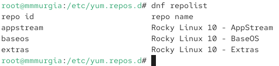
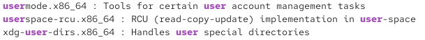
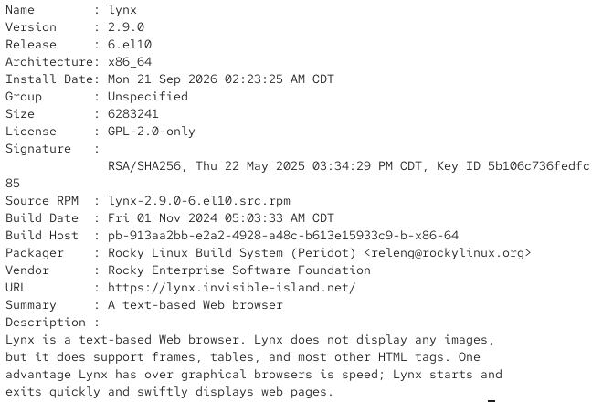
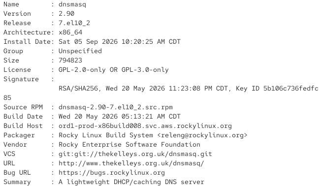

---
## Author
author:
  name: Мургия Марк Максимович
  degrees: DSc
  orcid: 0009-0006-9370-0808
  email: 1132243817@rudn.ru
  affiliation:
    - name: Российский университет дружбы народов
      country: Российская Федерация
      postal-code: 117198
      city: Москва
      address: ул. Миклухо-Маклая, д. 6
## Title
title: Лаб. раб. №4
subtitle: Работа с программными пакетами
license: CC BY
date: today
date-format: "YYYY-MM-DD" # Example: 2025-09-06
---

## Докладчик

:::::::::::::: {.columns align=center}
::: {.column width="70%"}

  * Мургия Марк Максимович
  * Студент
  * НПИбд-02-25
  * Российский университет дружбы народов им. П. Лумумбы
  * [1132243817@rudn.ru](mailto:1132243817@rudn.ru)

:::
::: {.column width="30%"}

:::
::::::::::::::

## Цель работы и задачи

Цель работы: Получить навыки работы с репозиториями и менеджерами пакетов.

1.  Изучить, как и в каких файлах подключаются репозитории для установки программного обеспечения; изучить основные возможности (поиск, установка, обновление, удаление пакета, работа с историей действий) команды dnf.
2. Изучить и повторить процесс установки/удаления определённого пакета с использованием возможностей dnf.
3. Изучить и повторить процесс установки/удаления определённого пакета с использованием возможностей rpm.

## Работа с репозиториями

## Использование rpm

## Установка пакета dnsmasq

## Вывод

С помощью команды dnf можно осуществлять поиск, установку, обновление, удаление пакета, и отображать историю действий. С помощью команды rpm можно получать информацию о состоянии пакетов.
