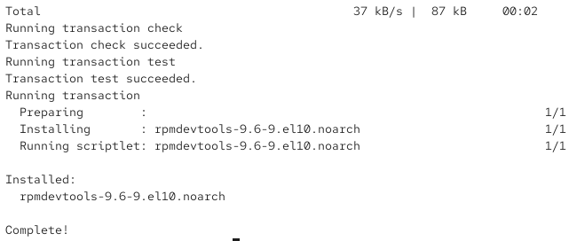
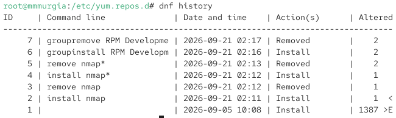
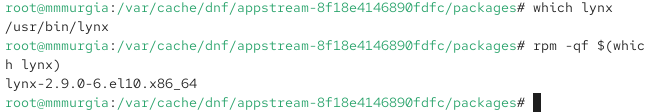
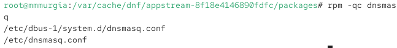

---
## Author
author:
  name: Мургия Марк Максимович
  degrees: DSc
  orcid: 0009-0006-9370-0808
  email: 1132243817@rudn.ru
  affiliation:
    - name: Российский университет дружбы народов
      country: Российская Федерация
      postal-code: 117198
      city: Москва
      address: ул. Миклухо-Маклая, д. 6

## Title
title: "Лабораторная работа №4"
subtitle: "Работа с програмными пакетами"
license: "CC BY"
---

# Цель работы

Получить навыки работы с репозиториями и менеджерами пакетов.

# Задание

1. Изучить, как и в каких файлах подключаются репозитории для установки программного обеспечения; изучить основные возможности (поиск, установка, обновление, удаление пакета, работа с историей действий) команды dnf.
2. Изучить и повторить процесс установки/удаления определённого пакета с использованием возможностей dnf.
3. Изучить и повторить процесс установки/удаления определённого пакета с использованием возможностей rpm.

# Теоретическое введение

dnf – пакетный менеджер на основе rpm, высокоуровневый

rpm – пакетный менеджер Red Hat, низкоуровневый

Более подробно про Unix см. в [@tanenbaum_book_modern-os_ru; @robbins_book_bash_en; @zarrelli_book_mastering-bash_en; @newham_book_learning-bash_en].

# Выполнение лабораторной работы

## Работа с репозиториями

Под пользователем root вывел на экран список репозиториев:

cd /etc/yum.repos.d

ls

cat rocky.repo

dnf repolist

{#fig-001 width=70%}

Команда показывает три репозитория: Appstream, BaseOS, и Extras.

Вывел на экран список пакетов, в названии или описании которых есть слово user:

dnf search user

{#fig-002 width=70%}

usermode.x86_64, userspace-rcu.x86_64, xdg-user-dirs.x86_64 

Установил nmap:

dnf search nmap

dnf info nmap

dnf install nmap

dnf install nmap\*

При dnf install nmap я установил только nmap, а с dnf install nmap\* я установил все доступные пакеты связанные с nmap.

Далее я удалил nmap:

dnf remove nmap

dnf remove nmap\*

Получил список имеющихся групп пакетов, затем установил группу пакетов RPM Development Tools:

dnf groups list

LANG=C dnf groups list

dnf groups info "RPM Development Tools"

dnf groupinstall "RPM Development Tools"

{#fig-003 width=70%}

Удалил группы пакетов RPM Development Tools командой

dnf groupremove "RPM Development Tools"

Посмотрел историю использования команды dnf:

dnf history

{#fig-004 width=70%}

Далее отменил последнее, например шестое по счёту, действие:

dnf history undo 6

## Использование rpm

Установка текстового браузера lynx из rpm-пакета.

Скачал rpm-пакет lynx:

dnf list lynx

dnf install lynx --downloadonly

Нашел каталог, в который был помещён пакет после загрузки:

find /var/cache/dnf/ -name lynx*

Перешел в этот каталог и затем установил rpm-пакет:

rpm -Uhv lynx-<версия>.rpm

Определил расположение исполняемого файла:

which lynx

Используя rpm, определил по имени файла, к какому пакету принадлежит lynx и получил дополнительную информацию о содержимом пакета:

rpm -qf $(which lynx)

rpm -qi lynx 

{#fig-005 width=70%}

Получил список всех файлов в пакете и вывел перечень файлов с документацией пакета:

rpm -ql lynx

rpm -qd lynx

Просмотр файлов документации командой man lynx.

Вывод на экран перечня и месторасположения конфигурационных файлов пакета:

rpm -qc lynx

Вывод на экран расположения и содержания скриптов, выполняемых при установке пакета:

rpm -q --scripts lynx

Скриптов команда не нашла

Под учетной записью mmmurgia запустил текстовый браузер lynx, чтобы проверить корректность установки пакета.

Под учётной записью root удалил пакет:

rpm -e lynx

ls

## Установка dnsmasq (DNS-, DHCP- и TFTP-сервер).

Установка пакета dnsmasq:

dnf list dnsmasq

dnf install dnsmasq

Определение расположения исполняемого файла:

which dnsmasq

Определение по имени файла, к какому пакету принадлежит dnsmasq:

rpm -qf $(which dnsmasq)

Дополнительная информация о содержимом пакета:

rpm -qi dnsmasq

Получение списка всех файлов в пакете:

rpm -ql dnsmasq

Вывод перечня файлов с документацией пакета:

rpm -qd dnsmasq

Просмотр файлов документации командой man dnsmasq.

Вывод на экран перечня и месторасположения конфигурационных файлов пакета:

rpm -qc dnsmasq

{#fig-006 width=70%}

Вывод на экран расположения и содержания скриптов, выполняемых при установке пакета:

rpm -q --scripts dnsmasq

Скрипты, выполняемые при установке пакета dnsmasq, предназначены для автоматизации системных задач, которые необходимы для корректной интеграции службы в операционную систему. 

Под учётной записью root удаление пакета:

rpm -e dnsmasq

# Контрольные вопросы

1. Какая команда позволяет вам искать пакет rpm, содержащий файл useradd?

Ответ: dnf provides

2. Какие команды вам нужно использовать, чтобы показать имя группы dnf, которая содержит инструменты безопасности и показывает, что находится в этой группе?

Ответ: dnf group list --hidden | grep -i security и dnf group info "Security Lab"

3. Какая команда позволяет вам установить rpm, который вы загрузили из Интернета и который не находится в репозиториях?

Ответ: dnf install

4. Вы хотите убедиться, что пакет rpm, который вы загрузили, не содержит никакого опасного кода сценария. Какая команда позволяет это сделать?

Ответ: rpm -qp --scripts имя_файла.rpm

5. Какая команда показывает всю документацию в rpm?

Ответ: rpm -d

6. Какая команда показывает, какому пакету rpm принадлежит файл?

Ответ: rpm -qf /путь/к/файлу

# Выводы

С помощью команды dnf можно осуществлять поиск, установку, обновление, удаление пакета, и отображать историю действий. С помощью команды rpm можно получать информацию о состоянии пакетов.

# Список литературы{.unnumbered}

::: {#refs}
:::
