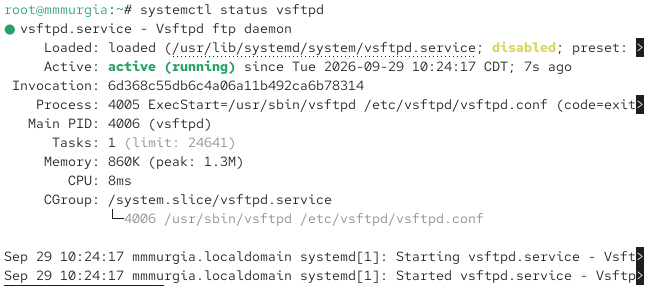
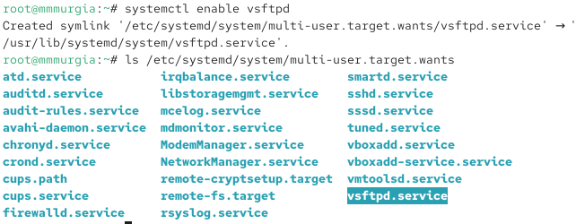
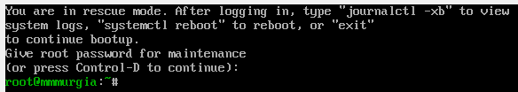

---
## Author
author:
  name: Мургия Марк Максимович
  degrees: DSc
  orcid: 0009-0006-9370-0808
  email: 1132243817@rudn.ru
  affiliation:
    - name: Российский университет дружбы народов
      country: Российская Федерация
      postal-code: 117198
      city: Москва
      address: ул. Миклухо-Маклая, д. 6
## Title
title: Лаб. раб. №5
subtitle: Работа с программными пакетами
license: CC BY
date: today
date-format: "YYYY-MM-DD" # Example: 2025-09-06
---

## Докладчик

:::::::::::::: {.columns align=center}
::: {.column width="70%"}

  * Мургия Марк Максимович
  * Студент
  * НПИбд-02-25
  * Российский университет дружбы народов им. П. Лумумбы
  * [1132243817@rudn.ru](mailto:1132243817@rudn.ru)

:::
::: {.column width="30%"}

:::
::::::::::::::

## Цель и задачи

Получить навыки управления системными службами операционной системы посредством systemd.

1. Выполнить основные операции по запуску (остановке), определению статуса, добавлению (удалению) в автозапуск и пр. службы Very Secure FTP.
2. Продемонстрировать навыки по разрешению конфликтов юнитов для служб firewalld и iptables.
3. Продемонстрировать навыки работы с изолированными целями.

## 1. Управление сервисами

## 2. Конфликты юнитов

## 3.-4.

## Вывод

В результате выполнения лабораторной работы были изучены операции по управлению службой Very Secure FTP. На примере служб firewalld и iptables изучены операции по разрешению конфликтов юнитов. Также проводились операции для работы с изолированными целями.
