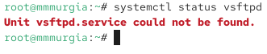
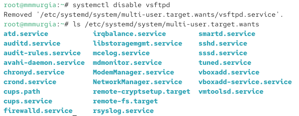
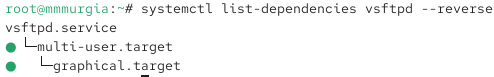
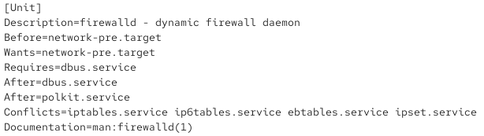
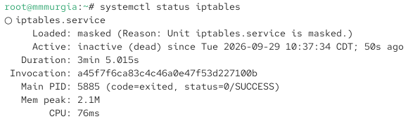
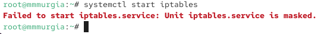

---
## Author
author:
  name: Мургия Марк Максимович
  degrees: DSc
  orcid: 0009-0006-9370-0808
  email: 1132243817@rudn.ru
  affiliation:
    - name: Российский университет дружбы народов
      country: Российская Федерация
      postal-code: 117198
      city: Москва
      address: ул. Миклухо-Маклая, д. 6

## Title
title: "Лабораторная работа №5"
subtitle: "Управление системными службами"
license: "CC BY"
---

# Цель работы

Получить навыки управления системными службами операционной системы посредством systemd.

# Задание

1. Выполнить основные операции по запуску (остановке), определению статуса, добавлению (удалению) в автозапуск и пр. службы Very Secure FTP.
2. Продемонстрировать навыки по разрешению конфликтов юнитов для служб firewalld и iptables.
3. Продемонстрировать навыки работы с изолированными целями.

# Теоретическое введение

systemd - system daemon

Very Secure FTP - FTP сервер

firewalld - firewall daemon

iptables - управление межсетевым экраном

# Выполнение лабораторной работы

## Управление сервисами

Проверка статуса службы Very Secure FTP:

systemctl status vsftpd

{#fig-001 width=70%}

Видим, что сервис отключён, так как служба Very Secure FTP не установлена.

Установка и запуск службы Very Secure FTP:

dnf -y install vsftpd

systemctl start vsftpd

Проверка статуса службы Very Secure FTP:

systemctl status vsftpd

{#fig-002 width=70%}

Видим, что служба работает, но не будет активирована при перезапуске операционной системы.

Добавление службы Very Secure FTP в автозапуск, проверка статуса, удаление.

systemctl enable vsftpd

systemctl status vsftpd

systemctl disable vsftpd

systemctl status vsftpd

Вывод на экран символических ссылок, ответственных за запуск различных сервисов:

ls /etc/systemd/system/multi-user.target.wants

{#fig-003 width=70%}

Видим, что ссылка на vsftpd.service не существует.

Добавление службы Very Secure FTP в автозапуск:

systemctl enable vsftpd

Вывод на экран ссылок

ls /etc/systemd/system/multi-user.target.wants

{#fig-004 width=70%}

Видим, что создана символическая ссылка для файла /usr/lib/systemd/system/vsftpd.service в каталоге.

Проверка статуса службы Very Secure FTP:

systemctl status vsftpd

Видим, что состояние изменено с disabled на enabled.

Вывод списка зависимостей юнита:

systemctl list-dependencies vsftpd

Вывод списка юнитов, которые зависят от данного юнита:

systemctl list-dependencies vsftpd –reverse

{#fig-005 width=70%}

## Конфликты юнитов

Установка iptables:

dnf -y install iptables\*

Проверка статуса firewalld и iptables:

systemctl status firewalld

systemctl status iptables

Пробный запуск firewalld и iptables:

systemctl start firewalld

systemctl start iptables

firewalld успешно запустился, а iptables не запустился.

Вводим

cat /usr/lib/systemd/system/firewalld.service

{#fig-006 width=70%}

На скрине указаны все конфликты для этого юнита.

То же самое делаем для второго юнита

cat /usr/lib/systemd/system/iptables.service

Получаем список конфликтов для этого юнита.

Выгружаем iptables и загружаем службу firewalld

systemctl stop iptables

systemctl start firewalld

Блокируем запуск iptables:

systemctl mask iptables

{#fig-007 width=70%}

Видим, что создана символическая ссылка на /dev/null для /etc/systemd/system/iptables.service.

Пробный запуск iptables:

systemctl start iptables

{#fig-008 width=70%}

Видим сообщение об ошибке, потому что служба замаскирована и не может быть запущена.

Добавление iptables в автозапуск:

systemctl enable iptables

Сервис неактивен, статус загрузки замаскированный.

## Изолируемые цели

Переходим в каталог systemd и находим список всех целей, которые можно изолировать:

cd /usr/lib/systemd/system

grep Isolate *.target

Переключаем операционную систему в режим восстановления:

systemctl isolate rescue.target

Перезапуск ОС:

systemctl isolate reboot.target

{#fig-009 width=70%}

## Цель по умолчанию

Вывод на экран цели по умолчанию:

systemctl get-default

Установил запуск по умолчанию текстового режима

systemctl set-default multi-user.target

Перегрузил систему командой reboot. 

Система загрузилась в текстовом режиме.

Запуск по умолчанию графического режима:

systemctl set-default graphical.target

Перегрузил систему командой reboot.

Система загрузилась в графическом режиме.

# Контрольные вопросы

1. Что такое юнит (unit)? Приведите примеры.

Ответ: юнит — это базовый объект конфигурации, который описывает конкретный ресурс системы и управляет им. ssh.service, graphical.target;

2. Какая команда позволяет вам убедиться, что цель больше не входит в список автоматического запуска при загрузке системы?

Ответ: systemctl status;

3. Какую команду вы должны использовать для отображения всех сервисных юнитов, которые в настоящее время загружены?

Ответ: systemctl list-units --type=service;

4. Как создать потребность (wants) в сервисе?

Ответ: Чтобы создать зависимость типа «потребность» (wants) между юнитами в systemd, необходимо использовать директиву Wants=;

5. Как переключить текущее состояние на цель восстановления (rescue target)?

Ответ: sudo systemctl isolate rescue.target;

6. Поясните причину получения сообщения о том, что цель не может быть изолирована.

Ответ: В конфигурационном файле этой цели отключен параметр AllowIsolate;

7. Вы хотите отключить службу systemd, но, прежде чем сделать это, вы хотите узнать, какие другие юниты зависят от этой службы. Какую команду вы бы использовали?

Ответ: systemctl list-dependencies --reverse имя_службы.service.

# Выводы

В результате выполнения лабораторной работы были изучены операции по управлению службой Very Secure FTP. На примере служб firewalld и iptables изучены операции по разрешению конфликтов юнитов. Также проводились операции для работы с изолированными целями.

# Список литературы{.unnumbered}

::: {#refs}
:::
