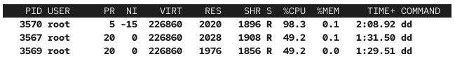
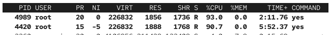

---
## Author
author:
  name: Мургия Марк Максимович
  degrees: DSc
  orcid: 0009-0006-9370-0808
  email: 1132243817@rudn.ru
  affiliation:
    - name: Российский университет дружбы народов
      country: Российская Федерация
      postal-code: 117198
      city: Москва
      address: ул. Миклухо-Маклая, д. 6
## Title
title: Лаб. раб. №6
subtitle: Управление процессами
license: CC BY
date: today
date-format: "YYYY-MM-DD" # Example: 2025-09-06
---

## Докладчик

:::::::::::::: {.columns align=center}
::: {.column width="70%"}

  * Мургия Марк Максимович
  * Студент
  * НПИбд-02-25
  * Российский университет дружбы народов им. П. Лумумбы
  * [1132243817@rudn.ru](mailto:1132243817@rudn.ru)

:::
::: {.column width="30%"}

:::
::::::::::::::

## Цель и задачи

Получить навыки управления процессами операционной системы.

1. Продемонстрировать навыки управления заданиями операционной системы.
2. Продемонстрировать навыки управления процессами операционной системы.
3. Выполнить задания для самостоятельной работы.

## Управление заданиями

## Управление процессами

## Самостоятельная работа

## Вывод

Для управления процессами, можно использовать команды: top, jobs, kill, killall. С помощью команд nice, renice можно устанавливать приоритеты. nohup позволяет команде не отключится при выходе.
