---
## Author
author:
  name: Мургия Марк Максимович
  degrees: DSc
  orcid: 0009-0006-9370-0808
  email: 1132243817@rudn.ru
  affiliation:
    - name: Российский университет дружбы народов
      country: Российская Федерация
      postal-code: 117198
      city: Москва
      address: ул. Миклухо-Маклая, д. 6

## Title
title: "Лабораторная работа №6"
subtitle: "Управление процессами"
license: "CC BY"
---

# Цель работы

Получить навыки управления процессами операционной системы.

# Задание

1. Продемонстрировать навыки управления заданиями операционной системы.
2. Продемонстрировать навыки управления процессами операционной системы.
3. Выполнить задания для самостоятельной работы.

# Теоретическое введение

ps - используется для просмотра информации о запущенных в данный момент процессах
top - встроенный интерактивный диспетчер задач, который показывает список работающих процессов и уровень использования системных ресурсов в реальном времени
htop - интерактивный монитор процессов в Linux, который показывает нагрузку на процессор, оперативную память и список запущенных программ в режиме реального времени

# Выполнение лабораторной работы

## Управление заданиями

Введем следующие команды под правами администратора:

sleep 3600 &

dd if=/dev/zero of=/dev/null &

sleep 7200

Ctrl + z, чтобы остановить процесс.

Команда jobs.

Отобразились три задания, которые мы запустили. Первые два в состоянии Running, а третий в Stopped.

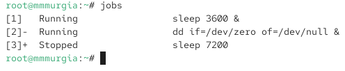{#fig-001 width=70%}

Введем bg 3 и команду jobs.

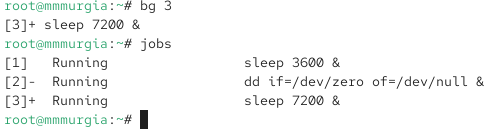{#fig-002 width=70%}

Теперь и третье задание в состоянии Running.

Чтобы переместить задание 1 на передний план введем fg 1.

С помощью Ctrl + c, отменим задание 1, а  потом проверим статус заданий командой jobs.

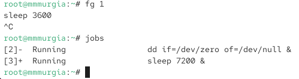{#fig-003 width=70%}

Видим, что первое задание в списке нет. Отменим так же задания 2 и 3.

Под моей учетной записью, ввожу на втором терминале dd if=/dev/zero of=/dev/null &.

Закрываю терминал командой exit.

На другом терминале под своей учётной записью запустил top и увидел что задание dd всё ещё запущено. Для выхода из top ввел q, снова запустил top, ввел k, чтобы убить задание dd и вышел из top.

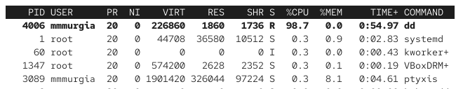{#fig-004 width=70%}

## Управление процессами

Под правами администратора ввел следующие команды:

dd if=/dev/zero of=/dev/null &

dd if=/dev/zero of=/dev/null &

dd if=/dev/zero of=/dev/null &

Далее ввел команду ps aux | grep dd

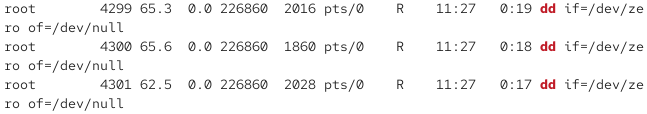{#fig-005 width=70%}

Видим все строки, в которых есть буквы dd. Запущенные процессы dd будут

последними.

Чтобы поменять приоритет, вводим renice -n 5 <PID>

Потом вводим ps fax | grep -B5 dd

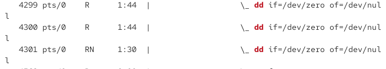{#fig-006 width=70%}

Видим, что у выбранного процесса приоритет выше других.

Вводим kill -9 <PID>, где вместо <PID> мы вводим идентификатор корневой оболчки.

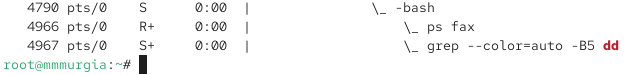{#fig-007 width=70%}

Видим, что корневая оболочка и все процессы dd закрылись.

## Самостоятельная работа

### Задание 1

Запустим команду dd if=/dev/zero of=/dev/null & трижды.

С помощью команды renice 

Увеличим приоритет одной из этих команд, используя значение приоритета −5. Потом изменим приоритет того же процесса ещё раз, но используем на этот раз значение −15. Значение -15 устанавливает более высокий приоритет чем -5.

{#fig-008 width=70%}

Завершаем все процессы dd командой kill.

### Задание 2

Проделываем следующие операции с программой yes:

Запуск программы в фоновом режиме с подавлением потока вывода, запуск на переднем плане, приостановка, запуск, завершение. Запуск на переднем плане без подавления потока вывода, приостановка, запуск, завершение. Проверка командой jobs.

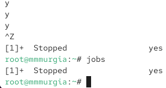{#fig-009 width=70%}

На данный момент, остался процесс yes, который был в фоновом режиме. 

Переведем процесс на передний план, затем остановим его.

Переведем этот же процесс в фоновый режим. Проверка командой jobs

![jobs 3]](image/10.png){#fig-010 width=70%}

Теперь процесс в состоянии Running.

Для запуска процесса в фоновом режиме, чтобы он не был связан с терминалом, конце строки вызова команды надо добавить &. И сделаем проверку открыв терминал еще раз.

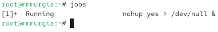{#fig-011 width=70%}

Вывод информации о процессах с помощью top.

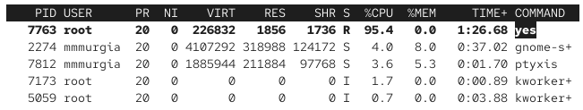{#fig-012 width=70%}

Запуск трех программ yes в фоновом режиме с подавлением потока вывода.

Один процесс убиваем используя PID, а другой используя идентификатор задания.

Обычный процесс можно убить, подав сигнал 1 (SIGHUP), а процесс, запущенный с nohup, нельзя, выдается ошибка.

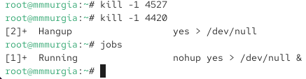{#fig-013 width=70%}

Запустим 6 программ yes в фоновом режиме с подавлением потока вывода.

Завершим их командой killall.

Запустим программу yes в фоновом режиме с подавлением потока вывода. Используя утилиту nice, запустим вторую yes с приоритетом, большим на 5. Используя top, выведем информацию о приоритетах. Абсолютные приоритеты 20 и 15, относительные приоритеты 0 и -5

С помощью renice, сделал так, чтобы приоритеты у обоих процессов был -5.

![renice]](image/18.png){#fig-014 width=70%}

# Контрольные вопросы

1. Какая команда даёт обзор всех текущих заданий оболочки?

Ответ: jobs

2. Как остановить текущее задание оболочки, чтобы продолжить его выполнение в фоновом режиме?

Ответ: Ctrl+Z и bg

3. Какую комбинацию клавиш можно использовать для отмены текущего задания оболочки?

Ответ: Ctrl + C

4. Необходимо отменить одно из начатых заданий. Доступ к оболочке, в которой в данный момент работает пользователь, невозможен. Что можно сделать, чтобы отменить задание?

Ответ: завершить его из другой терминальной сессии

5. Какая команда используется для отображения отношений между родительскими и дочерними процессами?

Ответ: pstree

6. Какая команда позволит изменить приоритет процесса с идентификатором 1234 на более высокий?

Ответ: renice

7. В системе в настоящее время запущено 20 процессов dd. Как проще всего остановить их все сразу?

Ответ: pkill dd

8. Какая команда позволяет остановить команду с именем mycommand?

Ответ: pkill mycommand

9. Какая команда используется в top, чтобы убить процесс?

Ответ: top k

10. Как запустить команду с достаточно высоким приоритетом, не рискуя, что не хватит ресурсов для других процессов?

Ответ: sudo nice -n -5 имя_команды

# Выводы

Для управления процессами, можно использовать команды: top, jobs, kill, killall. С помощью команд nice, renice можно устанавливать приоритеты. nohup позволяет команде не отключится при выходе.

# Список литературы{.unnumbered}

::: {#refs}
:::
