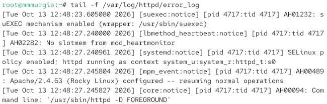
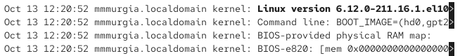
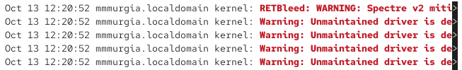
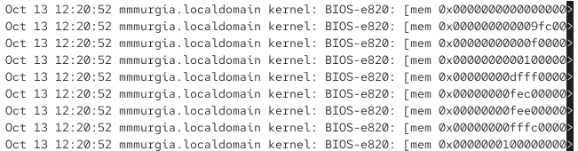
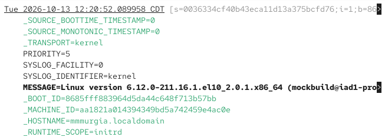
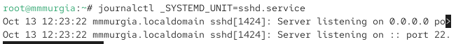

---
## Author
author:
  name: Мургия Марк Максимович
  degrees: DSc
  orcid: 0009-0006-9370-0808
  email: 1132243817@rudn.ru
  affiliation:
    - name: Российский университет дружбы народов
      country: Российская Федерация
      postal-code: 117198
      city: Москва
      address: ул. Миклухо-Маклая, д. 6

## Title
title: "Лабораторная работа №7"
subtitle: "Управление журналами событий в системе"
license: "CC BY"
---

# Цель работы

Получить навыки работы с журналами мониторинга различных событий в системе.

# Задание

1. Продемонстрировать навыки работы с журналом мониторинга событий в реальном времени.
2. Продемонстрировать навыки создания и настройки отдельного файла конфигурации мониторинга отслеживания событий веб-службы.
3. Продемонстрировать навыки работы с journalctl.
4. Продемонстрировать навыки работы с journald.

# Теоретическое введение

journalctl - консольная утилита в Linux для просмотра и управления системными логами, которые собирает демон systemd-journald

journald - встроенная в systemd системная служба (демон), которая собирает, индексирует и сохраняет логи операционной системы в бинарном формате

# Выполнение лабораторной работы

## Мониторинг журнала системных событий в реальном времени

Запустил три вкладки терминала с правами администратора:

su -

На второй вкладке терминала запустил мониторинг системных событий в реальном

времени:

tail -f /var/log/messages

В третьей вкладке терминала вышел из профиля администратора, попробовал снова зайти но ввел неправильный пароль. Во второй вкладке было сообщение «FAILED SU (to root) username ...».

{#fig-001 width=70%}

В третьей вкладке терминала ввел logger hello. Во второй вкладке было сообщение «hello».

{#fig-002 width=70%}

Во второй вкладке остановиk мониторинг в реальном времени, используя Ctrl + c. Затем вывел последние 20 строк мониторинг сообщений безопасности:

tail -n 20 /var/log/secure

Можно увидеть сообщение о неудачной попытке войти в учетную запись адинистратора.

{#fig-003 width=70%}

## Изменение правил rsyslog.conf

Надо настроить регистрацию сообщений веб-службы через syslog, для этого сделать следующее:

В первой вкладке терминала установил Apache:

dnf -y install httpd

Запустил веб-службу:

systemctl start httpd

systemctl enable httpd

Во второй вкладке терминала вывел журнал сообщений об ошибках веб-службы:

tail -f /var/log/httpd/error_log

{#fig-004 width=70%}

Закрыл журнал, используя Ctrl + c.

В третьей вкладке под правами администратора в файле конфигурации /etc/httpd/conf/httpd.conf добавил в конце строку:

ErrorLog syslog:local1

В каталоге /etc/rsyslog.d сделал файл мониторинга событий веб-службы:

cd /etc/rsyslog.d

touch httpd.conf

Открыл его на редактирование и прописал в нём

local1.* -/var/log/httpd-error.log

Теперь сообщения для local1 отправлятся в файл /var/log/httpd-error.log.

В первой вкладке перезагрузил конфигурацию rsyslogd и веб-службу:

systemctl restart rsyslog.service

systemctl restart httpd

Теперь сообщения об ошибках будут записаны в файле /var/log/httpd-error.log.

В третьей вкладке создал отдельный файл конфигурации для мониторинга отладочной информации:

cd /etc/rsyslog.d

touch debug.conf

В этом же терминале ввел

echo "*.debug /var/log/messages-debug" > /etc/rsyslog.d/debug.conf

Теперь сообщения об отладочной информации будут записаны в /var/log/messages-debug

В первой вкладке перезапустил rsyslogd:

systemctl restart rsyslog.service

Во второй вкладке запустил мониторинг отладочной информации:

tail -f /var/log/messages-debug

В третьей вкладке терминала ввел:

logger -p daemon.debug "Daemon Debug Message"

Во втором терминале появилось сообщение отладки.

{#fig-005 width=70%}

Закрыл трассировку файла журнала Ctrl + c .

## Использование journalctl

Во второй вкладке посмотрел содержимое журнала с событиями с момента последнего запуска системы:

Journalctl

{#fig-006 width=70%}

Чтобы просмотреть содержимого журнала без использования пейджера, надо ввести journalctl --no-pager.

Чтобы просмотреть журнал в реальном времени journalctl -f.

Чтобы просмотреть события для UID0, надо ввести journalctl _UID=0

{#fig-007 width=70%}

Для отображения последних 20 строк журнала, надо ввести journalctl -n 20

{#fig-008 width=70%}

Для просмотра только сообщений об ошибках, надо ввести journalctl -p err

{#fig-009 width=70%}

Для просмотра всех сообщений со вчерашнего дня, надо ввести journalctl --since yesterday

{#fig-010 width=70%}

Для просмотра сообщений с ошибкой приоритета, которые были зафиксированы со вчерашнего дня, надо ввести journalctl --since yesterday -p err

{#fig-011 width=70%}

Для просмотра детальной информации о событиях, надо ввести journalctl -o verbose

{#fig-012 width=70%}

Для просмотра дополнительной информации о модуле sshd, надо ввести journalctl _SYSTEMD_UNIT=sshd.service

{#fig-013 width=70%}

## Постоянный журнал journald

Надо сделать journald постоянным. Для этого:

Под правами администратора создал каталог для хранения записей журнала:

mkdir -p /var/log/journal

Изменил права доступа для каталога /var/log/journal, чтобы journald смог записывать в него информацию:

chown root:systemd-journal /var/log/journal

chmod 2755 /var/log/journal

{#fig-014 width=70%}

Чтобы зафиксировать изменения ввел команду killall -USR1 systemd-journald

Для просмотра сообщений журнала с момента последней перезагрузки ввел journalctl -b

# Контрольные вопросы

1. Какой файл используется для настройки rsyslogd?

Ответ: Основным файлом для настройки службы rsyslogd является /etc/rsyslog.conf

2. В каком файле журнала rsyslogd содержатся сообщения, связанные с аутентификацией?

Ответ: /var/log/secure

3. Если вы ничего не настроите, то сколько времени потребуется для ротации файлов журналов?

Ответ: По умолчанию ротация файлов журналов происходит раз в неделю.

4. Какую строку следует добавить в конфигурацию для записи всех сообщений с приоритетом info в файл /var/log/messages.info?

Ответ: *.info /var/log/messages.info

5. Какая команда позволяет вам видеть сообщения журнала в режиме реального времени?

Ответ: tail -f /var/log/syslog

6. Какая команда позволяет вам видеть все сообщения журнала, которые были написаны для PID 1 между 9:00 и 15:00?

Ответ: journalctl _PID=1 --since "09:00:00" --until "15:00:00"

7. Какая команда позволяет вам видеть сообщения journald после последней перезагрузки системы?

Ответ: journalctl -b

8. Какая процедура позволяет сделать журнал journald постоянным?

Ответ: необходимо изменить режим хранения в его конфигурационном файле.

# Тексты конфигурационных файлов

ErrorLog syslog:local1

local1.* -/var/log/httpd-error.log

*.debug /var/log/messages-debug

# Выводы

В Linux можно вызвать лог файлы, чтобы просмотреть системные события. В journalctl находятся события с момента последнего запуска системы.

# Список литературы{.unnumbered}

::: {#refs}
:::
