---
## Author
author:
  name: Мургия Марк Максимович
  degrees: DSc
  orcid: 0009-0006-9370-0808
  email: 1132243817@rudn.ru
  affiliation:
    - name: Российский университет дружбы народов
      country: Российская Федерация
      postal-code: 117198
      city: Москва
      address: ул. Миклухо-Маклая, д. 6

## Title
title: "Лабораторная работа №8"
subtitle: "Планировщики событий"
license: "CC BY"
---

# Цель работы

Получение навыков работы с планировщиками событий cron и at.

# Задание

1. Выполнить задания по планированию задач с помощью crond.
2. Выполнить задания по планированию задач с помощью atd.

# Теоретическое введение

сrond - фоновая служба в операционных системах Linux, которая автоматически запускает заданные пользователем или системой скрипты и команды по определенному расписанию

atd - системная служба (демон) в Linux, которая запускает команды и скрипты в определенное будущее время, но только один раз

# Выполнение лабораторной работы

## Планирование задач с помощью cron

Посмотрел статус демона crond, содержимое файла конфигурации /etc/crontab, список заданий в расписании:

systemctl status crond -l

cat /etc/crontab

crontab -l

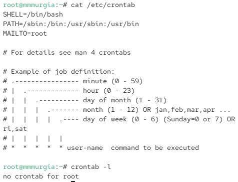{#fig-001 width=70%}

Ничего нет, так как расписание ещё не задано.

Открыл файл расписания, добавил в файл строку с записью сообщения в системный журнал:

crontab -e

*/1 * * * * logger This message is written from root cron

Закрыл vi и сохранил изменения.

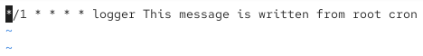{#fig-002 width=70%}

*/1 означает, что задание выполняется каждую минуту. Часы, дни, месяц и дни недели здесь не заданы. logger выводит сообщение в системный журнал. 

Вывел список заданий в расписании:

crontab -l

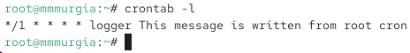{#fig-003 width=70%}

Появилась строка, которую я добавил в файл.

Через 3 минуты посмотрел журнал системных событий:

grep written /var/log/messages

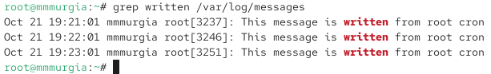{#fig-004 width=70%}

На экране вывелось три одинаковых сообщения.

Изменил запись в расписании crontab на 0 */1 * * 1-5 logger This message is written from root cron.

0 – нулевая минута, */1 – запуск каждый час, * - дни, * - месяц, 1-5 – с понедельника по пятницу. То есть, сообщение будет выводиться с понедельника по пятницу в начале каждого часа.

Посмотрел список заданий в расписании:

crontab -l

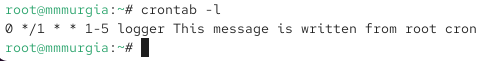{#fig-005 width=70%}

В каталоге /etc/cron.hourly создал файл сценария eachhour:

cd /etc/cron.hourly

touch eachhour

В файле eachhour добавил скрипт записи сообщения в системный журнал:

/bin/sh

logger This message is written at $(date)

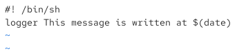{#fig-006 width=70%}

Сделал файл eachhour исполняемым:

chmod +x eachhour

В каталоге /etc/crond.d создал файл eachhour:

cd /etc/cron.d

touch eachhour

В файле eachhour прописал строку 11 * * * * root logger This message is written from /etc/cron.d

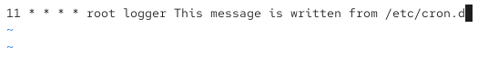{#fig-007 width=70%}

На 11 минуте каждого часа под правами администратора выведется сообщение в системный журнал.

Через 2 часа посмотрел журнал системных событий:

grep written /var/log/messages

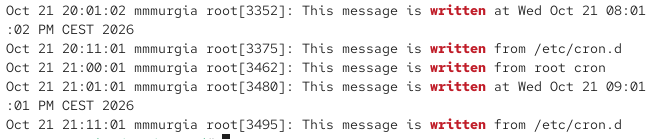{#fig-008 width=70%}

Вывелось два сообщения в 20:11 и 21:11 «This message is written from /etc/cron.d». То есть в соответствии с заданным расписанием (на 11 минуте каждого часа)

## Планирование заданий с помощью at

Проверил, что служба atd загружена и включена:

systemctl status atd

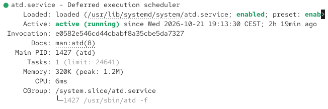{#fig-009 width=70%}

Задал выполнение команды logger message from at на 21:40 командой at 21:40.

Затем ввел logger message from at

Ввернулся в командную строку.

Проверка, что задание запланировано:

atq

Командой grep 'from at' /var/log/messages проверил, что сообщение «message from at» появилось в 21:40.

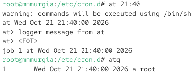{#fig=010 width=70%}

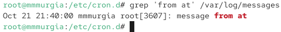{#fig-011 width=70%}

# Контрольные вопросы

1. Как настроить задание cron, чтобы оно выполнялось раз в 2 недели?

Ответ: 

2. Как настроить задание cron, чтобы оно выполнялось 1-го и 15-го числа каждого месяца в 2 часа ночи?

Ответ: 0 2 1,15 * * /path/to/script.sh

3. Как настроить задание cron, чтобы оно выполнялось каждые 2 минуты каждый день?

Ответ: */2 * * * * /path/to/script.sh

4. Как настроить задание cron, чтобы оно выполнялось 19 сентября ежегодно?

Ответ: 0 0 19 9 * /path/to/script.sh

5. Как настроить задание cron, чтобы оно выполнялось каждый четверг сентября ежегодно?

Ответ: 0 0 * 9 4 /path/to/script.sh

6. Какая команда позволяет вам назначить задание cron для пользователя alice? Приведите подтверждающий пример.

Ответ: sudo crontab -u alice -e

7. Как указать, что пользователю bob никогда не разрешено назначать задания через cron? Приведите подтверждающий пример.

Ответ: crontab -e

8. Вам нужно убедиться, что задание выполняется каждый день, даже если сервер во время выполнения временно недоступен. Как это сделать?

Ответ: 1   5   daily.job   /path/to/script.sh

9. Какая команда позволяет узнать, запланированы ли какие-либо задания на выполнение планировщиком atd?

Ответ: atq

# Выводы

В linux можно настраивать выполнение задач по расписанию. Для регулярных задач используется служба cron, для одноразовых задач используется служба at.

# Список литературы{.unnumbered}

::: {#refs}
:::
