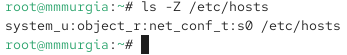
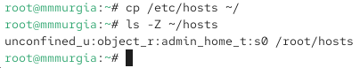
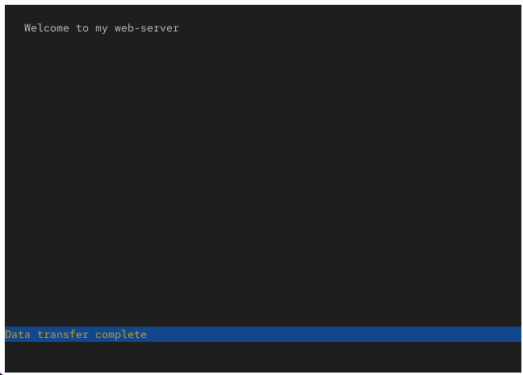
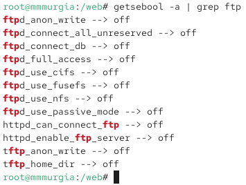
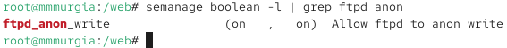

---
## Author
author:
  name: Мургия Марк Максимович
  degrees: DSc
  orcid: 0009-0006-9370-0808
  email: 1132243817@rudn.ru
  affiliation:
    - name: Российский университет дружбы народов
      country: Российская Федерация
      postal-code: 117198
      city: Москва
      address: ул. Миклухо-Маклая, д. 6
## Title
title: Лаб. раб. №9
subtitle: Управление SELinux
license: CC BY
date: today
date-format: "YYYY-MM-DD" # Example: 2025-09-06
---

## Докладчик

:::::::::::::: {.columns align=center}
::: {.column width="70%"}

  * Мургия Марк Максимович
  * Студент
  * НПИбд-02-25
  * Российский университет дружбы народов им. П. Лумумбы
  * [1132243817@rudn.ru](mailto:1132243817@rudn.ru)

:::
::: {.column width="30%"}

:::
::::::::::::::

## Цель и задачи

Получить навыки работы с контекстом безопасности и политиками SELinux.

1. Продемонстрировать навыки по управлению режимами SELinux.
2. Продемонстрировать навыки по восстановлению контекста безопасности SELinux.
3. Настроить контекст безопасности для нестандартного расположения файлов веб-службы.
4. Продемонстрировать навыки работы с переключателями SELinux.

## Управление режимами SELinux

## Использование restorecon для восстановления контекста безопасности

## Настройка контекста безопасности для нестандартного расположения файлов веб-сервера

## Работа с переключателями SELinux

## Вывод

Для управления режимами SELinux, используют команду setenforce. Командой restorecon можно восстановить контекст безопасности. В SELinux можно устанавливать переключатели для различных служб.
