---
## Author
author:
  name: Мургия Марк Максимович
  degrees: DSc
  orcid: 0009-0006-9370-0808
  email: 1132243817@rudn.ru
  affiliation:
    - name: Российский университет дружбы народов
      country: Российская Федерация
      postal-code: 117198
      city: Москва
      address: ул. Миклухо-Маклая, д. 6

## Title
title: "Лабораторная работа №9"
subtitle: "Управление SELinux"
license: "CC BY"
---

# Цель работы

Получить навыки работы с контекстом безопасности и политиками SELinux.

# Задание

1. Продемонстрировать навыки по управлению режимами SELinux.
2. Продемонстрировать навыки по восстановлению контекста безопасности SELinux.
3. Настроить контекст безопасности для нестандартного расположения файлов веб-службы.
4. Продемонстрировать навыки работы с переключателями SELinux.

# Теоретическое введение

SELinux – встроенный в ядро Linux модуль безопасности, который реализует систему мандатного (принудительного) контроля доступа (MAC)

Режимы работы SELinux:

– Enforcing (режим принудительного исполнения) — действия, нарушающие политику безопасности, блокируются, попытка нарушения фиксируется в журнале;
– Permissive (разрешающий режим) — действия, нарушающие политику безопасности, не блокируются, но попытка нарушения фиксируется в журнале;
– Disabled (режим отключения SELinux) — полное отключение системы принудительного контроля доступа.

sestatus - это стандартная утилита в Linux для проверки состояния подсистемы безопасности SELinux

getenforce – показывает текущий режим работы модуля безопасности SELinux (Security-Enhanced Linux) в операционных системах Linux

# Выполнение лабораторной работы

## Управление режимами SELinux

Под правами администратора, просмотрел текущую информацию о состоянии SELinux:

sestatus -v

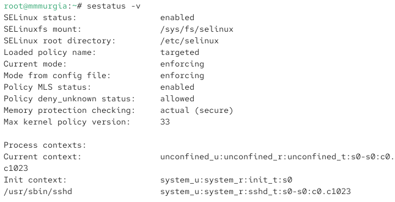{#fig-001 width=70%}

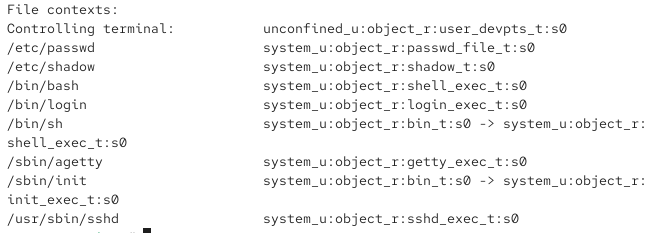{#fig-002 width=70%}

Выведен отчет:

Состояние модуля – включено,

модуль привязан к /sys/fs/selinux, 

администратор может найти модуль в каталоге /etc/selinux, 

имя активного набора правил безопасности – targeted, 

текущий режим модуля – enforcing, 

режим в файле конфигурации – enforcing, 

политика многоуровневой безопасности включена,

Политика разрешений действий, для которых не определены явные правила, включена,

Политика защиты памяти включена,

Максимальная версия политики безопасности: 33,

Текущий контекст: unconfined_u:confined_r:unconfined_t:s0-s0:c0

Контекст при инициализации: system_u:system_r:init_t:s0

Контекст в каталоге /usr/sbin/sshd: system_u:system_r:sshd_t:s0-s0:c0.c1023

Контекст управления терминалом: unconfined_u:object_r:user_devpts_t:s0

Контекст в файлах /etc/passwd: system_u:object_r:passwd_file_t:s0

Контекст в файлах /etc/shadow: system_u:object_r:shadow_t:s0

Контекст в файлах /bin/bash: system_u:object_r:shell_exec_t:s0

Контекст в файлах /bin/login: system_u:object_r:login_exec_t:s0

Контекст в файлах /bin/sh: system_u:object_r:shell_exec_t:s0

Контекст в файлах /sbin/agetty: system_u:object_r:getty_exec_t:s0

Контекст в файлах /sbin/init: system_u:object_r:init_exec_t:s0

Контекст в файлах /usr/sbin/sshd: system_u:object_r:sshd_exec_t:s0

Проверка, в каком режиме работает SELinux:

getenforce

В режиме принудительного исполнения (Enforcing).

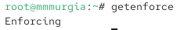{#fig-003 width=70%}

Я изменил режим работы SELinux на разрешающий (Permissive) и проверил режим изменился:

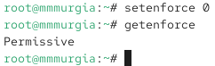{#fig-004 width=70%}

setenforce 0

getenforce

В файле /etc/sysconfig/selinux поменял одну из строк на

SELINUX=disabled

И перезагрузил систему.

Под правами администратора, проверил статус SELinux:

getenforce

Текущий статус disabled (отключен).

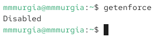{#fig-005 width=70%}

Попытка переключить режим работы SELinux:

setenforce 1

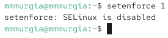{#fig-006 width=70%}

Появляется сообщение, что модуль отключен, переключиться нельзя.

В файле /etc/sysconfig/selinux установил

SELINUX=enforcing

И перезагрузил.

Под правами администратора проверил статус SELinux:

sestatus -v

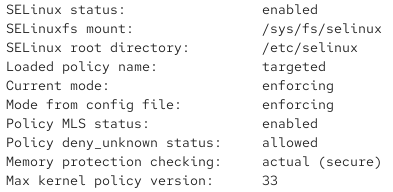{#fig-007 width=70%}

Модуль теперь работает в принудительном режиме (enforcing).

## Использование restorecon для восстановления контекста безопасности

Под правами администратора, посмотрел контекст безопасности файла /etc/hosts:

ls -Z /etc/hosts

{#fig-008 width=70%}

У файла есть метка контекста net_conf_t.

Скопировал файл /etc/hosts в домашний каталог:

cp /etc/hosts ~/

Проверил контекст файла ~/hosts:

ls -Z ~/hosts

{#fig-009 width=70%}

Параметр контекста в файле ~/hosts стал admin_home_t.

Попытка перезаписать существующий файл hosts из домашнего каталога в каталог /etc:

mv ~/hosts /etc.

Проверка: тип контекста остался admin_home_t:

ls -Z /etc/hosts

Исправил контекст безопасности:

restorecon -v /etc/hosts

Проверка, что тип контекста изменился на предыдущий контекст безопасности:

ls -Z /etc/hosts

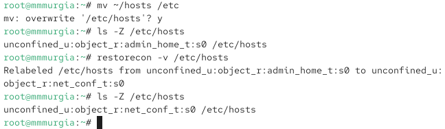{#fig-010 width=70%}

Для массового исправления контекста безопасности надо ввести touch /.autorelabel и перезагрузите систему.

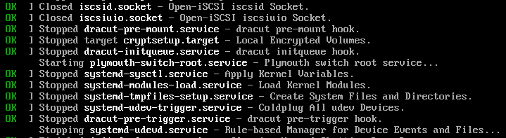{#fig-011 width=70%}

Вся файловая система перемаркирована.

## Настройка контекста безопасности для нестандартного расположения файлов веб-сервера

Под правами администратора установил ПО:

dnf -y install httpd

dnf -y install lynx

Создал новое хранилище для файлов web-сервера:

mkdir /web

Создал файл index.html в каталоге с контентом веб-сервера:

cd /web

touch index.html

Записал в файл текст:

Welcome to my web-server

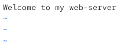{#fig-012 width=70%}

В файл /etc/httpd/conf/httpd.conf внес изменения

#DocumentRoot "/var/www/html" 

DocumentRoot "/web"

#Directory "/var/www"

#AllowOverride None

#Require all granted

#/Directory

Directory "/web"

AllowOverride None

Require all granted

/Directory

Запустил веб-сервер и службу httpd:

systemctl start httpd

systemctl enable httpd

Под своей учётной записью запустил lynx и проверил локальный веб-сервер:

lynx http:// localhost

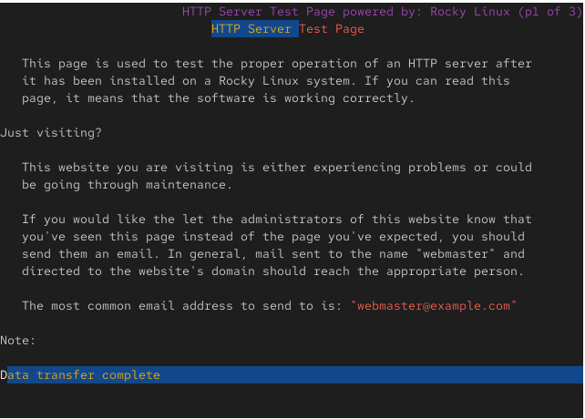{#fig-013 width=70%}

Выводится страница Red Hat.

Под правами администратора создал новую метку контекста:

semanage fcontext -a -t httpd_sys_content_t "/web(/.*)?"

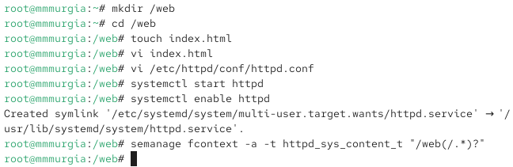{#fig-014 width=70%}

Восстановил контекст безопасности:

restorecon -R -v /web

Под своей учётной записью снова запустил lynx:

lynx http:// localhost

{#fig-015 width=70%}

Теперь выводится надпись «Welcome to my web-server».

## Работа с переключателями SELinux

Под правами администратора посмотрел список переключателей SELinux для службы ftp:

getsebool -a | grep ftp

{#fig-016 width=70%}

Можно увидеть ftpd_anon_write с текущим значением off.

Для службы ftpd_anon посмотрел список переключателей:

semanage boolean -l | grep ftpd_anon

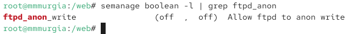{#fig-017 width=70%}

Первый переключатель отвечает за текущее значение, а второй – за постоянное значение, и оба выключены.

Изменил текущее значение переключателя с off на on:

setsebool ftpd_anon_write on

Повторно посмотрел список переключателей:

getsebool ftpd_anon_write

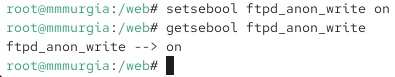{#fig-018 width=70%}

Посмотрел список переключателей с пояснением:

semanage boolean -l | grep ftpd_anon

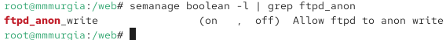{#fig-019 width=70%}

Переключатель текущего значения включен, а постоянного отключен.

Изменил постоянное значение переключателя для службы ftpd_anon_write с off на on:

setsebool -P ftpd_anon_write on

Посмотрел список переключателей:

semanage boolean -l | grep ftpd_anon

{#fig-020 width=70%}

Оба переключателя включены.

# Контрольные вопросы

1. Вы хотите временно поставить SELinux в разрешающем режиме. Какую команду вы используете?

Ответ: sudo setenforce 0

2. Вам нужен список всех доступных переключателей SELinux. Какую команду вы используете?

Ответ: getsebool -a

3. Каково имя пакета, который требуется установить для получения легко читаемых сообщений журнала SELinux в журнале аудита?

Ответ: setroubleshoot-server

4. Какие команды вам нужно выполнить, чтобы применить тип контекста httpd_sys_content_t к каталогу /web?

Ответ: sudo semanage fcontext -a -t httpd_sys_content_t "/web(/.)?"; sudo restorecon -R -v /web

5. Какой файл вам нужно изменить, если вы хотите полностью отключить SELinux?

Ответ: /etc/selinux/config

6. Где SELinux регистрирует все свои сообщения?

Ответ: /var/log/audit/audit.log

7. Вы не знаете, какие типы контекстов доступны для службы ftp. Какая команда позволяет получить более конкретную информацию?

Ответ: seinfo -t | grep ftp

8. Ваш сервис работает не так, как ожидалось, и вы хотите узнать, связано ли это с SELinux или чем-то ещё. Какой самый простой способ узнать?

Ответ: sudo setenforce 0; sudo systemctl restart имя_сервиса

# Выводы

Для управления режимами SELinux, используют команду setenforce. Командой restorecon можно восстановить контекст безопасности. В SELinux можно устанавливать переключатели для различных служб.

# Список литературы{.unnumbered}

::: {#refs}
:::
