---
## Author
author:
  name: Мургия Марк Максимович
  degrees: DSc
  orcid: 0009-0006-9370-0808
  email: 1132243817@rudn.ru
  affiliation:
    - name: Российский университет дружбы народов
      country: Российская Федерация
      postal-code: 117198
      city: Москва
      address: ул. Миклухо-Маклая, д. 6

## Title
title: "Лабораторная работа №10"
subtitle: "Основы работы с модулями ядра операционной системы"
license: "CC BY"
---

# Цель работы

Получить навыки работы с утилитами управления модулями ядра операционной системы.

# Задание

1. Продемонстрировать навыки работы по управлению модулями ядра.
2. Продемонстрировать навыки работы по загрузке модулей ядра с параметрами.

# Теоретическое введение

modprobe — загрузка/выгрузка модулей

modinfo — вывод информации о модуле

lsmod — вывод всех загруженных модулей в виде таблицы

# Выполнение лабораторной работы

## Управление модулями ядра из командной строки

Посмотрел, какие устройства имеются в системе и какие модули ядра с ними связаны:

lspci -k

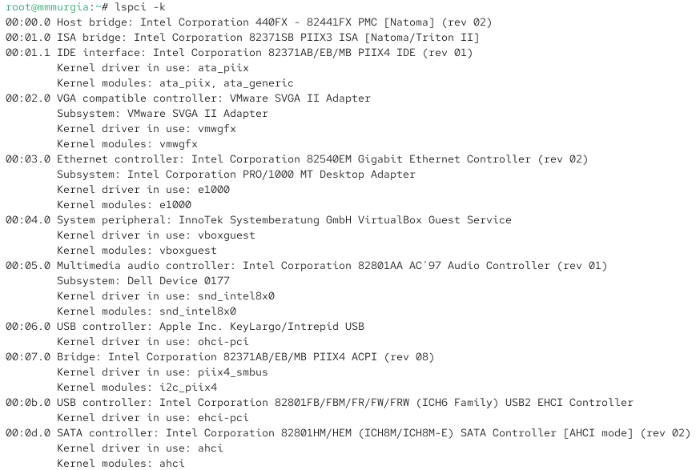{#fig-001 width=70%}

Выведена информация об устройствах, например, разъем Ethernet и USB. Информация о модулях ядра обозначено как Kernel modules.

Посмотрел, какие модули ядра загружены:

lsmod | sort

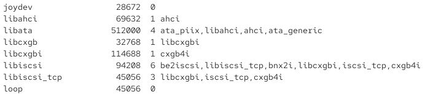{#fig-002 width=70%}

Посмотрел, загружен ли модуль ext4:

lsmod | grep ext4

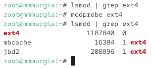{#fig-003 width=70%}

Он не установлен. Поэтому загрузил модуль ядра ext4:

modprobe ext4

Проверка, что модуль загружен:

lsmod | grep ext4

Вывел информацию о модуле ядра ext4:

modinfo ext4

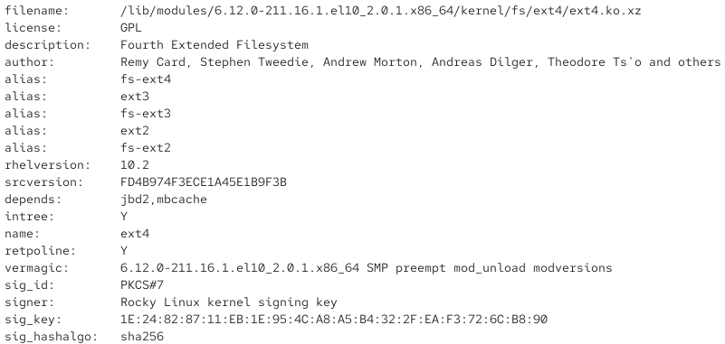{#fig-004 width=70%}

В нее входит расположение файла, лицензия, описание, создатели, обычное и другие имена, версия, контрольную сумму исходных файлов, от каких других модулей зависит, находится ли исходный код внутри официального репозитория Linux, индексы защиты и информация о сигнатуре модуля.

Выгрузил модуль ядра ext4:

modprobe -r ext4

Никакой информация не выдается, так как модуль удален.

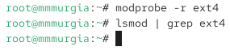{#fig-005 width=70%}

Попытка выгрузить модуль ядра xfs:

modprobe -r xfs

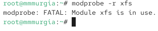{#fig-006 width=70%}

Выводится сообщение об ошибке FATAL, так как модуль на данный момент используется.

## Загрузка модулей ядра с параметрами

Посмотрел, загружен ли модуль bluetooth:

lsmod | grep bluetooth

Он не загружен. Загрузил модуль ядра bluetooth:

modprobe bluetooth

Посмотрел список модулей ядра, отвечающих за работу с Bluetooth:

lsmod | grep bluetooth

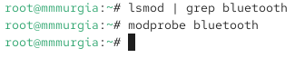{#fig-007 width=70%}

Посмотрел информацию о модуле bluetooth:

modinfo bluetooth

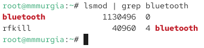{#fig-008 width=70%}

Для работы модуля могут быть установлены параметры: eSCO (расширенное синхронное соединение), улучшенный режим ретрансляции и расширенный режим Credit Flow Control.

Выгрузил модуль ядра bluetooth:

modprobe -r bluetooth

## Обновление ядра системы

Посмотрел версию ядра, используемую в операционной системе:

uname -r

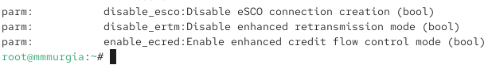{#fig-009 width=70%}

Вывел список пакетов, относящихся к ядру ОС:

dnf list kernel

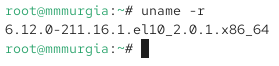{#fig-010 width=70%}

Обновил систему, чтобы обновились все пакеты, потом обновил ядро и еще раз обновил ОС:

dnf upgrade --refresh

dnf update kernel

dnf update

dnf upgrade --refresh

После перезагрузки, выбрал новое ядро и посмотрел его версию:

uname -r

hostnamectl

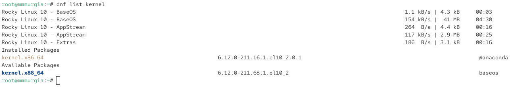{#fig-011 width=70%}

# Вонтрольные вопросы

1. Какая команда показывает текущую версию ядра, которая используется на вашей системе?

Ответ: uname -r

2. Как можно посмотреть более подробную информацию о текущей версии ядра операционной системы?

Ответ: cat /proc/version

3. Какая команда показывает список загруженных модулей ядра?

Ответ: lsmod

4. Какая команда позволяет вам определять параметры модуля ядра?

Ответ: modinfo

5. Как выгрузить модуль ядра?

Ответ: modprobe -r имя_модуля

6. Что вы можете сделать, если получите сообщение об ошибке при попытке выгрузить модуль ядра?

Ответ: sudo systemctl stop имя_службы

7. Как определить, какие параметры модуля ядра поддерживаются?

Ответ: modinfo -p имя_модуля

8. Как установить новую версию ядра?

Ответ: dnf upgrade

# Выводы

В ядро ОС можно загружать и выгружать модули для расширения функционала. Для управления модулями ядра, используют утилиты modprobe, modinfo и lsmod.

# Список литературы{.unnumbered}

::: {#refs}
:::
