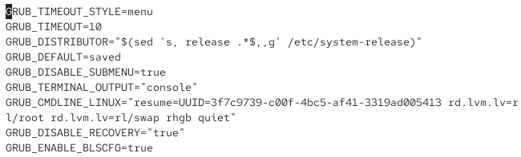
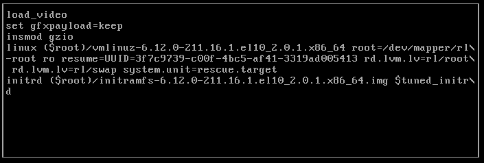
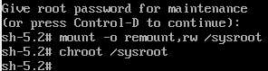

---
## Author
author:
  name: Мургия Марк Максимович
  degrees: DSc
  orcid: 0009-0006-9370-0808
  email: 1132243817@rudn.ru
  affiliation:
    - name: Российский университет дружбы народов
      country: Российская Федерация
      postal-code: 117198
      city: Москва
      address: ул. Миклухо-Маклая, д. 6
## Title
title: Лаб. раб. №11
subtitle: Управление загрузкой системы
license: CC BY
date: today
date-format: "YYYY-MM-DD" # Example: 2025-09-06
---

## Докладчик

:::::::::::::: {.columns align=center}
::: {.column width="70%"}

  * Мургия Марк Максимович
  * Студент
  * НПИбд-02-25
  * Российский университет дружбы народов им. П. Лумумбы
  * [1132243817@rudn.ru](mailto:1132243817@rudn.ru)

:::
::: {.column width="30%"}

:::
::::::::::::::

## Цель и задачи

Цель работы: Получить навыки работы с загрузчиком системы GRUB2.

1. Продемонстрировать навыки по изменению параметров GRUB и записи изменений в файл конфигурации.
2. Продемонстрировать навыки устранения неполадок при работе с GRUB.
3. Продемонстрировать навыки работы с GRUB без использования root.

## Модификация параметров GRUB2

## Устранения неполадок

## Сброс пароля root

## Вывод

в Linux можно изменять параметры загрузчика GRUB и записывать изменения в файл конфигурации. Чтобы устранять неполадки в работе GRUB, нужно загружать ОС с минимальным количеством системных единиц. Пароль root можно установить, если загружать систему в минимальном режиме.