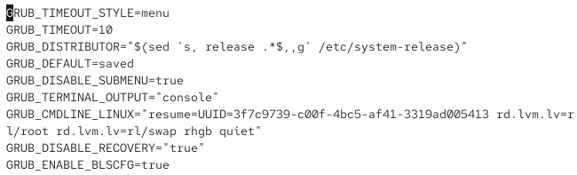
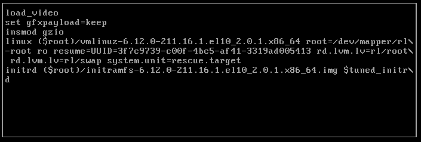
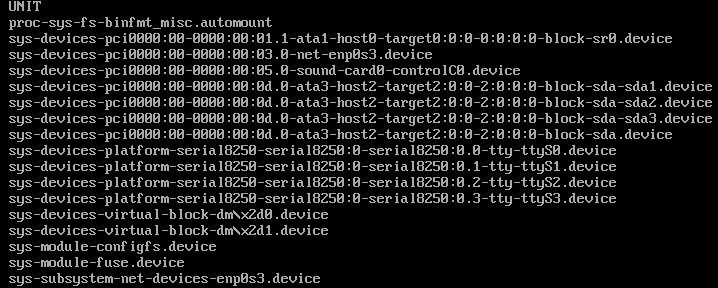
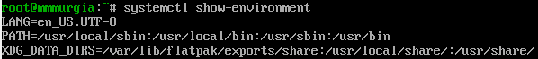
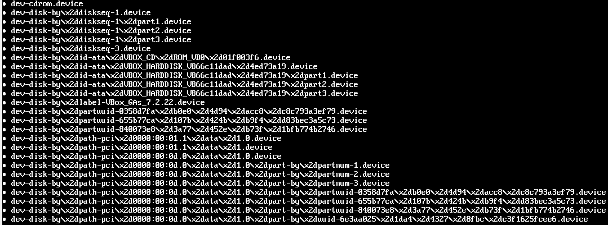
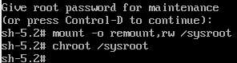

---
## Author
author:
  name: Мургия Марк Максимович
  degrees: DSc
  orcid: 0009-0006-9370-0808
  email: 1132243817@rudn.ru
  affiliation:
    - name: Российский университет дружбы народов
      country: Российская Федерация
      postal-code: 117198
      city: Москва
      address: ул. Миклухо-Маклая, д. 6

## Title
title: "Лабораторная работа №11"
subtitle: "Управление загрузкой системы"
license: "CC BY"
---

# Цель работы

Получить навыки работы с загрузчиком системы GRUB2.

# Задание

1. Продемонстрировать навыки по изменению параметров GRUB и записи изменений в файл конфигурации.
2. Продемонстрировать навыки устранения неполадок при работе с GRUB.
3. Продемонстрировать навыки работы с GRUB без использования root.

# Теоретическое введение

Наиболее распространённый загрузчик для Unix/Linux операционных систем — GRUB (GRand Unified Bootloader). Определить версию загрузчика можно с помощью команды grub2-install –version. Основной файл конфигурации GRUB2 — /boot/grub2/grub.cfg. Этот файл генерируется автоматически с помощью файла настроек /etc/default/grub и скриптов из директории /etc/grub.d.

# Выполнение лабораторной работы

## Модификация параметров GRUB2

В файле /etc/default/grub установил параметр отображения меню загрузки в течение 10 секунд:

GRUB_TIMEOUT=10

Я еще добавил строку, которая включает меню GRUB2:

GRUM_TIMEOUT_STYLE=menu

{#fig-001 width=70%}

Сохранил изменения в файле.

Записал изменения в GRUB2, введя в командной строке

grub2-mkconfig > /boot/grub2/grub.cfg

Перезагрузил систему и появилось меню GRUB2.12.

## Устранения неполадок

После перезагрузки, нужно зажать клавишу Shift, когда запустится GRUB, чтобы открыть меню выбора ядра.

Я выбрал строку с текущей версией ядра в меню и нажал e для редактирования.

{#fig-002 width=70%}

В строку, которая отвечает за загрузку ядра системы, я дописал

systemd.unit=rescue.target

и удалил опции rhgb и quiet.

Нажал Ctrl + x для продолжения процесса загрузки.

Ввел пароль пользователя root при появлении запроса.

Посмотрел список всех файлов модулей, которые загружены в настоящее время:

systemctl list-units

{#fig-003 width=70%}

Загрузилась базовая системная среда.

Посмотрел задействованные переменные среды оболочки:

systemctl show-environment

{#fig-004 width=70%}

Перегрузил систему, используя команду

systemctl reboot

В конце строки, загружающей ядро, я ввел

systemd.unit=emergency.target

и удалил опции rhgb и quiet.

Нажал Ctrl + x для продолжения процесса загрузки.

Ввел пароль пользователя root.

После успешного входа в систему посмотрел список всех загруженных файлов модулей:

systemctl list-units

{#fig-005 width=70%}

Количество загружаемых файлов модулей стало меньше.

Перезагрузил систему, используя команду:

systemctl reboot

## Сброс пароля root

Чтобы сбросить пароль root, нужно загрузить систему в минимальном режиме, который позволяет войти в систему без ввода пароля.

Перезагрузил компьютер. В конце строки, загружающей ядро, я ввел

rd.break

и удалил опции rhgb и quiet.

Нажал Ctrl + x для продолжения процесса загрузки.

Загрузка системы остановилась на initramfs.

Для доступа к системному образу для чтения и записи, набрал

mount -o remount,rw /sysroot

Сделал содержимое каталога /sysimage новым корневым каталогом, набрав

chroot /sysroot

{#fig-006 width=70%}

Установил новый пароль root командой

Passwd

Чтобы установить тип контекста, загрузил SELinux командой

load_policy -i

И установил правильный тип контекста для /etc/shadow командой

chcon -t shadow_t /etc/shadow

Перезагрузил систему с помощью команды reboot -f и вошел в систему с под новым паролем.

# Контрольные вопросы

1. Какой файл конфигурации следует изменить для применения общих изменений в GRUB2?

Ответ: /etc/default/grub

2. Как называется конфигурационный файл GRUB2, в котором вы применяете изменения для GRUB2?

Ответ: /boot/grub2/grub.cfg

3. После внесения изменений в конфигурацию GRUB2, какую команду вы должны выполнить, чтобы изменения сохранились и воспринялись при загрузке системы?

Ответ: grub2-mkconfig > /boot/grub2/grub.cfg

# Выводы

В Linux можно изменять параметры загрузчика GRUB и записывать изменения в файл конфигурации. Чтобы устранять неполадки в работе GRUB, нужно загружать ОС с минимальным количеством системных единиц. Пароль root можно установить, если загружать систему в минимальном режиме.

# Список литературы{.unnumbered}

::: {#refs}
:::
