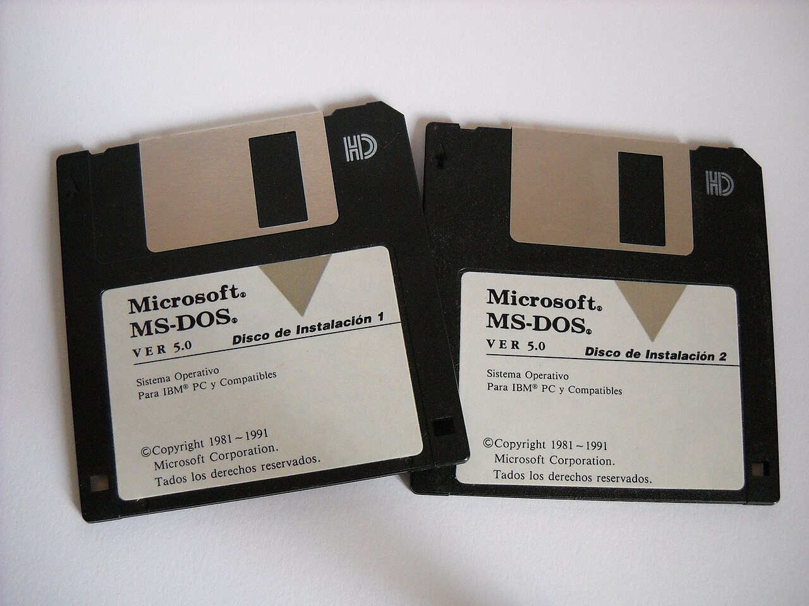
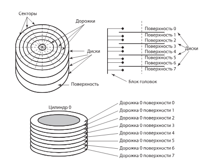
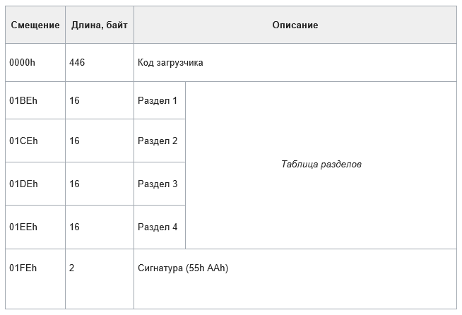
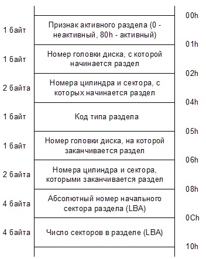
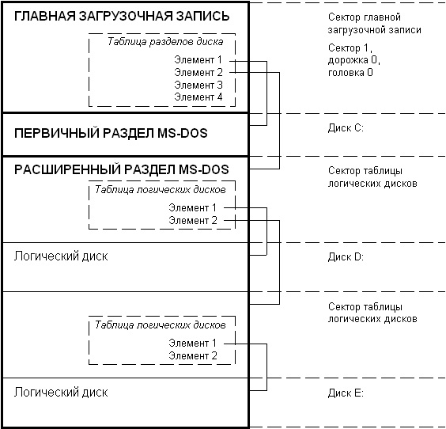
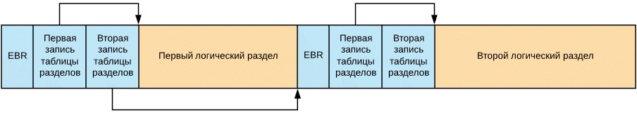
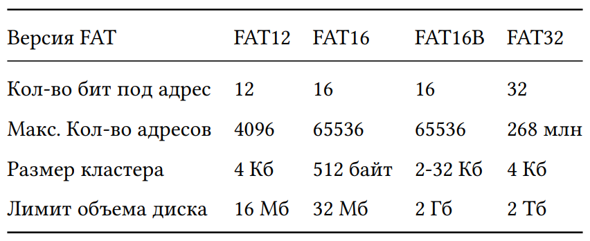
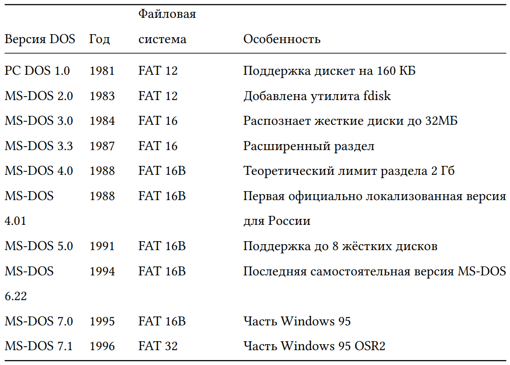

---
## Author
author:
  name: Мургия Марк Максимович
  degrees: DSc
  orcid: 0009-0006-9370-0808
  email: 1132243817@rudn.ru
  affiliation:
    - name: Российский университет дружбы народов
      country: Российская Федерация
      postal-code: 117198
      city: Москва
      address: ул. Миклухо-Маклая, д. 6
## Title
title: Доклад
subtitle: Схема разбиения MS-DOS
license: CC BY
date: today
date-format: "YYYY-MM-DD" # Example: 2025-09-06
---

## Докладчик

:::::::::::::: {.columns align=center}
::: {.column width="70%"}

  * Мургия Марк Максимович
  * Студент
  * НПИбд-02-25
  * Российский университет дружбы народов им. П. Лумумбы
  * [1132243817@rudn.ru](mailto:1132243817@rudn.ru)

:::
::: {.column width="30%"}

:::
::::::::::::::

## Введение

MS-DOS — однопрограммная однопользовательская ОС с интерфейсом командной строки. 

Актуальность темы: схема разбиения MS- DOS стала мировым стандартом, который лег в основу архитектуры всех последующих систем Microsoft. 

Объект исследования: архитектура хранения данных на жестких дисках персональных компьютеров.

Предмет исследования: структура, ограничения и принципы работы схемы разбиения MS-DOS (MBR).

Цель и задачи исследования: изучить принципы физической и логической организации диска в MS-DOS, ознакомиться с концепцией MBR.

## Краткая история MS-DOS

:::::::::::::: {.columns align=center}
::: {.column width="30%"}

:::
::: {.column width="70%"}

- 1980: Microsoft покупает 86-DOS у Seattle Computer Products (SCP).
- Разработка PC-DPS (Personal Computer Disk Operating System) для компаний IBM.
- MS-DOS (Microsoft Disk Operating System) - та же ОС под собственным брендом.
- 1981: первый IBM PC с первой версией PC DOS 1.0. 

Продается 30000 компьютеров в месяц. "Наш самый оптимистичный взгляд на количество машин, использующих MS-DOS, не соответствовал тому, что на самом деле произошло." (с) Билл Гейтс

- 1984: MS-DOS лидирует на рынке ОС.
- 1988: первая официально локализованная версия для России.
- 1993: последняя самостоятельная версия MS-DOS 6.22. Далее как часть Windows.
- Вышло 8 основных версий и около 20 промежуточных. 

:::
::::::::::::::

## Физическая структура жесткого диска

:::::::::::::: {.columns align=center}
::: {.column width="50%"}

- Дорожки (tracks) – концентрические окружности на поверхности дисков
- Цилиндр (cylinder) – дорожки одного диаметра на всех дисках пакета
- Головка чтения/записи диска (head)
- Сектор (sector) – участок дорожки, минимальная единица хранения данных
- CHS (cylinder-head-sector/ цилиндр-головка-сектор) - система адресации данных в старых компьютерах

:::
::: {.column width="50%"}

:::
::::::::::::::

## Главная загрузочная запись (Master Boot Record, MBR) 

:::::::::::::: {.columns align=center}
::: {.column width="50%"}

:::
::: {.column width="50%"}

PC DOS 2.0 (1983)

MBR хранится в первом секторе диска (CHS 0:0:1, цилиндр 0, головка 0, сектор 1) 

Размер сектора 512 байт

1. Загрузочный код (446 байт)
2. Таблица разделов диска (partition table, 64 байта): 4 записи по 16 байт

Сигнатура MBR (2 байта) 

:::
::::::::::::::

## Структура записи таблицы разделов

:::::::::::::: {.columns align=center}
::: {.column width="50%"}

- флаг активности (загрузочный раздел или нет)
- координаты раздела (начальный и конечный сектора)
- код типа раздела / файловой системы

4 записи = можно разметить только 4 основных (primary) раздела

:::
::: {.column width="50%"}

:::
::::::::::::::

## Типы разделов в MS-DOS. Расширенный раздел

:::::::::::::: {.columns align=center}
::: {.column width="50%"}

:::
::: {.column width="50%"}

Основной (первичный, primary partition)

Расширенный (extended partition) - чтобы обойти ограничение в 32 МБ (DOS 3.3, 1987 год)

Ограничения fdisk до DOS 5.0: на диске можно было создать только один основной раздел

Пример разбиения диска утилитой fdisk

1 основной раздел C:, до 32 МБ, активный, для загрузки MS-DOS

1 расширенный раздел, без буквы, не активный, «контейнер» для логических дисков от D: до Z: каждый до 32 МБ, с них нельзя загружать ОС

:::
::::::::::::::

## Принцип работы расширенного раздела (EBR, Extended Boot Record)

## Файловая система. Ограничения FAT

:::::::::::::: {.columns align=center}
::: {.column width="50%"}

Файловая система — порядок, определяющий способ организации, хранения и именования данных на носителях информации (жестких дисках, SSD, флешках).

FAT (File Allocation Table, Таблица размещения файлов) – в MS-DOS и Windows до 2001 года 

FAT16

2^16 = 65536 (количество адресов)

65536*512 байта (размер сектора) =33554435 байт = 32МБ (максимальный объем диска)

FAT16B

65536*32КБ (размер кластера) = 2 ГБ (максимальный объем диска)

:::
::: {.column width="50%"}

:::
::::::::::::::

## Эволюция MS-DOS

## Заключение

Запуск MS-DOS - начало новой эры в компьютерной индустрии. Сделала компьютеры доступными для широкой аудитории. 

MS-DOS установила стандарты для командной строки, файловой системы и стала основой для первых версий Windows.

Преимущества: простота, надежность. 

Применение в наше время: промышленное оборудование (станки с ЧПУ), транспорт (авиация и ж/д), работа со старым софтом через эмуляторы типа DOSBox (бухгалтерские программы, старые игры).

## Список литературы

1. История создания MS-DOS: Как 75 тысяч долларов изменили судьбу Microsoft  // Хабр : \[сайт\]. — 2024. — URL: [Ссылка](https://habr.com/ru/companies/first/articles/856212/) (дата обращения 15.10.2026)
2. 30 лет MS-DOS // Хабр : \[сайт\]. — 2011. — URL: [Ссылка](https://habr.com/ru/articles/125115/) (дата обращения 15.10.2026)
3. Википедия — свободная энциклопедия : \[сайт\]. – URL: [Ссылка](https://ru.wikipedia.org/wiki/) (дата обращения 15.10.2026) 
4. Рудаков А. В. Операционные системы и среды : учебник // Рудаков А. В. – Москва: Курс: Инфра-М, 2027. – 304 с. 
5. Фролов A., Фролов Г. MS-DOS для программиста : учебное пособие // Фролов А., Фролов Г. – т. 19 – Москва : Диалог-МИФИ, 1995. – 253 с. – Текст : электронный // Библиотека братьев Фроловых [сайт]. – URL: [Ссылка](https://www.frolov-lib.ru/books/bsp/v19/ch2_1.html) (дата обращения: 1.11.2026)
6. MBR или GPT? Что такое структуры накопителей и чем отличаются // DNS клуб, блог : \[сайт\]. – 2021. – URL: [Ссылка](https://club.dns-shop.ru/blog/t-477-ssd-nakopiteli-m-2/40496-mbr-ili-gpt-chto-takoe-strukturyi-nakopitelei-i-chem-otlichautsya/) (дата обращения: 1.11.2026)
7. Изучаем структуры MBR и GPT // Хабр : \[сайт\]. – 2018. – URL: [Ссылка](https://habr.com/ru/articles/347002/) (дата обращения: 2.11.2026)