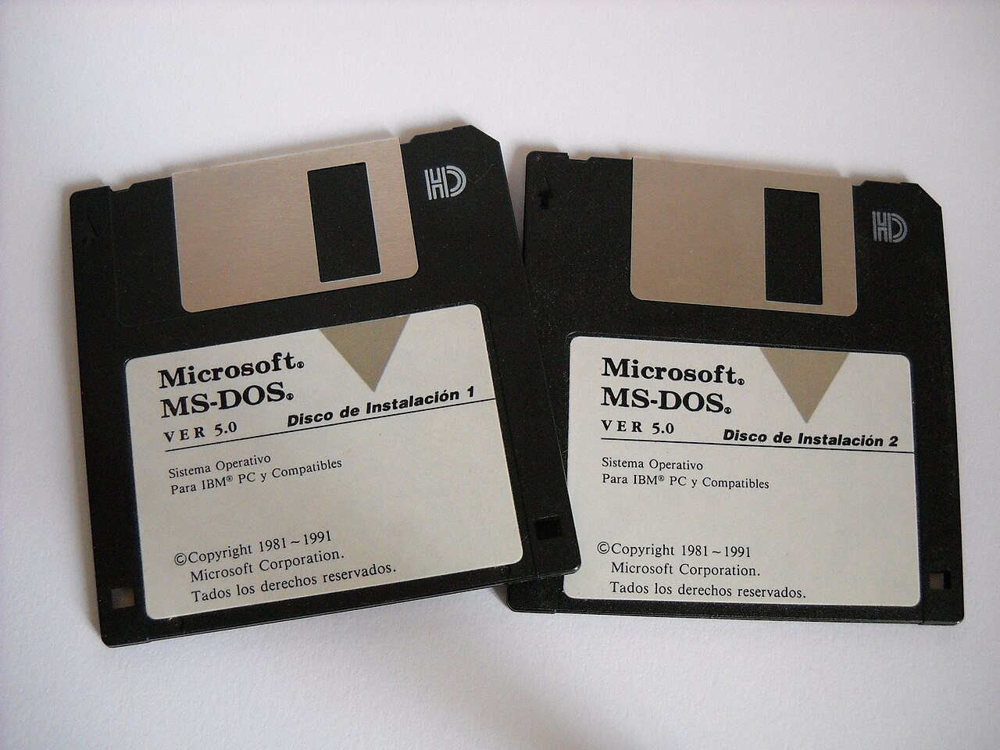
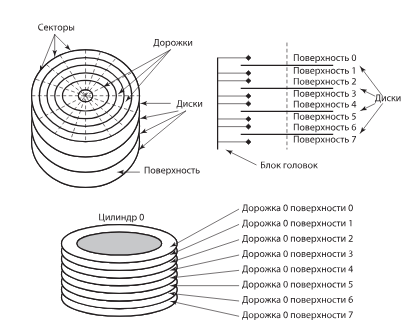
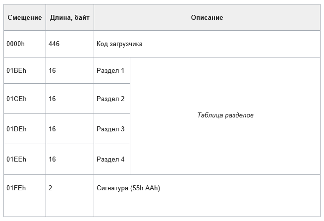
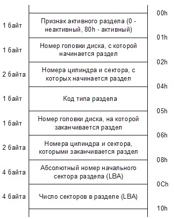
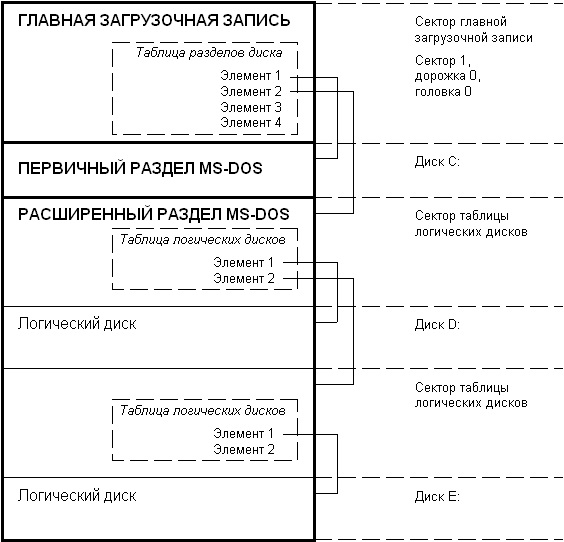
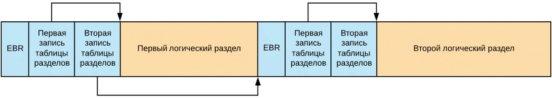

---
## Author
author:
  name: Мургия Марк Максимович
  degrees: DSc
  orcid: 0009-0006-9370-0808
  email: 1132243817@rudn.ru
  affiliation:
    - name: Российский университет дружбы народов
      country: Российская Федерация
      postal-code: 117198
      city: Москва
      address: ул. Миклухо-Маклая, д. 6

## Title
title: "РЕФЕРАТ"
subtitle: "на тему Схема разбиения MS-DOS"
license: "CC BY"
---

# Введение

MS-DOS — однопрограммная однопользовательская операционная система с интерфейсом командной строки. Появилась в 1981 году и была самой популярной до середины 1990-х годов, пока её не вытеснили операционные системы с графическим пользовательским интерфейсом (Windows).

Актуальность изучения схемы разбиения MS- DOS состоит в том, что она стала мировым стандартом, который лег в основу архитектуры всех последующих систем Microsoft. 

Объектом исследования в данной работе является архитектура хранения данных на жестких дисках персональных компьютеров.

Предмет исследования: структура, ограничения и принципы работы схемы разбиения MS-DOS (MBR).

Цель и задачи исследования: изучить принципы физической и логической организации диска в MS-DOS, ознакомиться с концепцией Master Boot Record.

Реферат состоит из введения, основной части, заключения и списка литературы.

# Краткая история MS-DOS

В 1980 году компания IBM запустила проект по созданию первого персонального компьютера IBM PC. Операционную систему для него предложила компания Microsoft, на тот момент малоизвестная. За 75000 долларов Microsoft купила готовую систему 86-DOS у компании Seattle Computer Products (SCP), доработала ее и назвала MS-DOS (Microsoft Disk Operating System).

12 августа 1981 года был выпущен персональный компьютер IBM PC с первой версией ОС. За первый год IBM продавала 30 000 компьютеров в месяц, что оказалось настоящим успехом. Даже сам Билл Гейтс говорил: «Наш самый оптимистичный взгляд на количество машин, использующих MS-DOS, не соответствовал тому, что на самом деле произошло».

К декабрю 1984 года MS-DOS заняла лидирующие позиции на рынке операционных систем. К июню 1986 года MS-DOS приносила половину доходов Microsoft, это около 60 миллионов долларов. Всего вышло восемь основных версий MS-DOS и около двадцати промежуточных обновлений. 

Первая официально локализованная версия для России вышла в декабре 1988 года.

С выходом Windows 95 эпоха DOS как самостоятельной операционной системы закончилась. Последняя самостоятельная версия MS-DOS 6.22 вышла в 1993 году. Все последующие версии MS-DOS уже стали частью операционной системы Windows. [@habr01; @habr02]

{#fig-001 width=70%}

[@wikipedia]

# Физическая структура жесткого диска

Жесткий диск состоит из одного или нескольких стеклянных или металлических дисков (пакета дисков), покрытых с одной или двух сторон магнитным материалом, и блока головок, с помощью которых происходит считывание и запись данных на диск. На поверхности дисков размечены концентрические окружности (дорожки). Дорожки нумеруются с нуля от внешнего края к центру. Дорожки одного диаметра (с одинаковыми номерами) на всех дисках пакета образуют цилиндр. Цилиндры нумеруют, начиная с нулевого. Все дорожки разделены на отдельные участки одинакового размера – сектора. Сектора нумеруют, начиная с единицы. Сектор – наименьшая адресуемая единица обмена данными дискового устройства с оперативной памятью. [@rudakov]

{#fig-002 width=70%}

[@rudakov]

Дорожки и секторы создаются при физическом (низкоуровневом) форматировании диска на заводе-изготовителе. Разметка диска под конкретный тип файловой системы создается при логическом (высокоуровневом) форматировании. [@rudakov]

# Зачем нужно разбиение диска. Ограничения ранних версий DOS

Первые IBM PC, выпущенные в 1981 году, были укомплектованы только дискетами. Односторонние дискеты вмещали всего 160 Кб, позже появились двухсторонние дискеты на 320 и 360 Кб. На одной дискете обычно находилась сама DOS и одна-две программы или игры. Не было необходимости делить такие малые объемы на еще меньшие части. 

Проблемы возникли, когда появились жесткие диски на 40 Мб и больше. Оказалось, что используемая в DOS на тот момент файловая система FAT 16 не позволяла использовать диски объемом большим, чем 32 Мб. [@frolov]

Объяснение этого ограничения будет дано позже.

В 1987 году в DOS 3.3 появилась возможность разбивать физический диск на логические, каждый из которых не превышал 32Мб. Начиная с DOS 4.0 это ограничение на размер логического диска было снято, при этом схема разделения физического диска на логические диски полностью сохранилась. 

Другие причины, по которым может быть полезно разделение большого диска на части: 

- в случае повреждения логического диска пропадает только та информация, которая находилась на этом логическом диске; 
- реорганизация и выгрузка диска маленького размера выполняется быстрее, чем большого; 
- на одном диске может находиться несколько различных операционных систем, расположенных в разных разделах. В ходе начальной загрузки вы можете указать раздел диска, из которого должна загружаться нужная вам в данный момент операционная система. [@frolov]

# Главная загрузочная запись (Master Boot Record, MBR)

Концепция Master Boot Record (MBR) впервые появилась в 1983 году в PC DOS 2.0. 

В чем она заключается:

В процессе загрузки компьютера вначале всегда отрабатывается BIOS. Кроме тестирования и инициализации оборудования, идет выбор устройства, с которого будет происходить дальнейшая загрузка. Если устройство имеет только один раздел (дискета), загрузка продолжается сразу с этого устройства. Если устройство содержит несколько разделов, каждый из которых потенциально может быть загрузочным, нужно сделать выбор. Возникла идея использовать для этого небольшую программу, записанную на самом носителе. Так появилась концепция MBR. [@wikipedia]

{#fig-003 width=70%}

[@dnsclub]

MBR хранится в самом первом физическом секторе накопителя (цилиндр 0, головка 0, сектор 1 или Cylinder Head Sector CHS 0:0:1). Его размер 512 байт. MBR состоит из двух частей:

1. Загрузочный код (446 байт), к которому обращается BIOS после включения питания, он определяет, какой раздел является активным (загрузочным), и передаёт ему управление для запуска ОС.
2. Таблица разделов диска (partition table, 64 байта), показывает, как жесткий диск разделен на логические части (разделы/partition). Состоит из четырех записей по 16 байт. В каждой записи указаны границы раздела (начальный и конечный сектор), его размер, тип раздела и файловой системы на нем.

В последних двух байтах первого сектора записана сигнатура MBR (0x55AA или AA55h) – маркер для BIOS, который подтверждает, что диск размечен и с него можно пытаться загружаться. Если сигнатура неверна и записаны другие данные, BIOS определяет диск как незагрузочный и выдает ошибку («Invalid partition table», «Disk boot failure») или пытается загрузиться со следующего устройства.

# Структура таблицы разделов MBR

Под таблицу разделов в MBR выделено 64 байта. Чтобы описать один физический раздел диска требовалось минимум 16 байт данных. Таким образом MBR позволял создать только 4 основных раздела (64/16 = 4). В ранних версиях MBR это считалось достаточным.

Структура одной 16-байтной записи:

- флаг активности (указывает BIOS, является этот раздел загрузочным или нет),
- координаты начала и конца раздела в формате CHS (cylinder-head-sector/цилиндр-головка-сектор - старый метод адресации в ранних ПК),
- код типа раздела / файловой системы,
- координаты раздела в формате LBA (logical block addressing - современный метод адресации, где секторы просто нумеруются по порядку от 0 до конца диска) и общий размер раздела. [@wikipedia]

{#fig-004 width=70%}

[@habr03]

Как происходит загрузка ОС

При запуске компьютера BIOS читает первый сектор накопителя (где находится главная загрузочная запись MBR), выполняется код загрузчика, который просматривает таблицу разделов и находит активный раздел. Если активных разделов несколько, выводится сообщение о необходимости выбора активного раздела для продолжения загрузки. После того как активный раздел найден, главная загрузочная запись считывает самый первый сектор раздела, этот сектор содержит загрузочную запись (Boot Record), которой передается управление. Загрузочная запись активного раздела выполняет загрузку операционной системы, находящейся в активном разделе. [@frolov]

# Типы разделов в MS-DOS. Расширенный раздел

Разделы диска могут быть двух типов: основной (первичный, primary partition) и расширенный (extended partition). 

Расширенный раздел был придуман в Microsoft, чтобы обойти ограничение в 32 Мб, поскольку в это время появились жесткие диски объемом 40, 80, 100 Мб. Это было реализовано в 1987 году в версии DOS 3.3., и MBR принял свой окончательный классический вид (Standard MBR). [@wikipedia]

Для разметки и управления разделами на жёстких дисках в MS-DOS использовалась утилита fdisk («fixed disk»). С помощью нее можно было создавать и удалять основные и расширенные разделы, обозначать активный раздел. Однако программа fdisk работала с ограничениями: на одном физическом диске fdisk могла создать только один основной раздел для DOS. Остальные слоты в таблице MBR можно было использовать для других ОС, но применяя сторонние утилиты. [@wikipedia]

На практике это работало так: 

Fdisk создает на жестком диске один основной (первичный) раздел MS-DOS размером до 32 Мб и один расширенный раздел на оставшемся пространстве. Первичный раздел должен быть активным, он получает букву С:, и из него выполняется загрузка MS-DOS. Расширенный раздел разбивается программой fdisk на логические диски D:, E: и так далее, каждый размером до 32 Мб. Расширенный раздел не имеет буквенного обозначения, служит «контейнером» для логических дисков, он не может быть активным, следовательно, невозможно выполнить загрузку операционной системы с логических дисков, расположенных в этом разделе. [@frolov]

{#fig-005 width=70%}

[@frolov]

Принцип работы расширенного раздела
Внутри расширенного раздела создается цепочка собственных таблиц разделов логических дисков (EBR, Extended Boot Record). Каждый логический диск описывается своей записью, которая ссылается на следующий логический диск, образуя связанный список.
EBR похожа по структуре на MBR, но имеет следующие отличия:
- В ней нет исполняемого загрузочного кода.
- Таблица разделов в EBR содержит только две записи. Первая запись указывает на текущий логический диск. Вторая запись (если она не пустая) указывает на следующий сектор EBR, описывающий следующий логический диск в цепочке. Если логический раздел последний в списке, то вторая запись должна быть заполнена нулями.
В конце EBR, так же, как и в MBR, находится сигнатура AA55h. 
Таким образом, чтобы найти все логические диски, ОС должна последовательно считывать секторы EBR, двигаясь по цепочке внутри расширенного раздела. 

{#fig-006 width=70%}

[@habr03]

# Файловая система. Ограничения FAT

Файловая система — это порядок, определяющий способ организации, хранения и именования данных на носителях информации (жестких дисках, SSD, флешках).

В MS-DOS и версиях Windows до 2001 года использовалась файловая система FAT (File Allocation Table или Таблица размещения файлов), которая была разработана Биллом Гейтсом и Марком МакДональдом еще в 1977 году.

Когда Microsoft создавала DOS, решили, что единицей хранения данных будет не сектор (размер которого составлял 512 байт), а группа смежных секторов, которую назвали кластером. Каждому кластеру соответствует элемент таблицы FAT, содержащий информацию о том, свободен данный кластер или занят данными файла. 

На сегодняшний день существует четыре версии FAT: FAT12, FAT16, FAT32 и exFAT (FAT64) (последняя используется в портативных накопителях, например, SDD и флешках). Версии различаются разрядностью таблицы, то есть количеством бит, которое выделяется на хранение одного адреса (12, 16, 32 бит). [@wikipedia]

## FAT-12

Использовалась в DOS ниже версии 3.x. Поскольку адрес кластера 12-битный, число записей в таблице составит 2^12 = 4096 записей. Максимальный размер кластера в FAT12 составлял 4 КБ (или 8 секторов по 512 байт). Умножив 4096 * 4 КБ, получим лимит размера диска 16 МБ. То есть DOS ниже версии 3.0 не распознавала диски больше 16 МБ. В то время жесткие диски имели емкость 5 МБ и 10 МБ, поэтому этого лимита хватало. FAT-12 до сих пор используется в портативной электронике или в ретро-компьютерах, на дискетах. 

## FAT16

Первая версия FAT16 с 16-битной разрядностью появилась в DOS 3.0. С 16 битами можно было записать 2^16 = 65536 адресов. Умножив на 512 байт (размер сектора), получим лимит 65536*512=33554435 байт = 32МБ.

В DOS 4.0 появилась FAT16B, в которой размеры кластеров увеличили до 32 КБ (в некоторых версиях до 64 КБ). Умножив 65536*32 КБ, получим максимальный объем диска 2 ГБ. Это окончательная версия FAT16, какой мы знаем её сегодня, и она же применялась в первой версии Windows 95. 

Увеличение кластера привело к проблеме, называемой slack space. Файловая система не может выделить файлу меньше, чем один целый кластер. Например, при FAT-16B и размере кластера 32КБ, файл размером 100 КБ займет четыре кластера или 128 КБ. В этом случае дополнительные 28 КБ ничего не содержат, они тратятся впустую.

## FAT-32

Появилась в 1996 году в Windows 95 OSR2. Фактически использует не 32-битную адресацию, а 28-битную. При этом количество возможных адресов составит более 268 млн (2 в 28 степени). При таком количестве адресов можно было использовать кластеры маленького размера. Лимит объема диска теоретически вырос до 2 ТБ.

| Версия FAT            | FAT12 | FAT16    | FAT16B  | FAT32   |
|-----------------------|-------|----------|---------|---------|
| Кол-во бит под адрес  | 12    | 16       | 16      | 28      |
| Макс. кол-во адресов  | 4096  | 65536    | 65536   | 268 млн |
| Размер кластера       | 4 Кб  | 512 байт | 2-32 Кб | 4 Кб    |
| Лимит размера раздела | 16 Мб | 32 Мб    | 2 Гб    | 2 Тб    |

: Сравнение версий FAT {#tbl-std-dir-1}

# Эволюция MS-DOS

| Версия DOS      | Год   | Файловая система | Особенность                                        |
|-----------------|-------|------------------|----------------------------------------------------|
| PC DOS 1.0      | 1981  | FAT 12           | Поддержка дискет на 160 КБ                         |
| MS-DOS 2.0      | 1983  | FAT 12           | Добавлена утилита fdisk                            |
| MS-DOS 3.0      | 1984  | FAT 16           | Распознает жесткие диски до 32МБ                   |
| MS-DOS 3.3      | 1987  | FAT 16           | Расширенный раздел                                 |
| MS-DOS 4.0      | 1988  | FAT 16B          | Теоретический лимит раздела 2 Гб                   |
| MS-DOS 4.01     | 1988  | FAT 16B          | Первая локализованная версия для России            |
| MS-DOS 6.22     | 1994  | FAT 16B          | Последняя самостоятельная версия                   |
| MS-DOS 7.0      | 1995  | FAT 16B          | Часть Windows 95                                   |
| MS-DOS 7.1      | 1996  | FAT 32           | Часть Windows 95 OSR2                              |

: Версии и возможности MS-DOS  {#tbl-std-dir-2} [@wikipedia]

# Заключение

Запуск MS-DOS стал началом новой эры в компьютерной индустрии. До ее появления персональные компьютеры использовались в основном энтузиастами, но MS-DOS сделала компьютеры доступными для широкой аудитории. 

MS-DOS установила стандарты для командной строки, файловой системы и стала основой для первых версий Windows. Со временем она уступила место более современным ОС, но ее влияние на индустрию неоспоримо. [@habr01]

Благодаря своей простоте и надежности, MS-DOS и ее аналоги до сих пор используются в некоторых областях, например, в промышленном оборудовании (станки с ЧПУ), на транспорте (авиация и ж/д - для загрузки навигационных баз данных и диагностики оборудования), для работы со старым софтом (бухгалтерские программы, старые игры запускают внутри эмуляторов типа DOSBox или виртуальных машин).

# Список литературы{.unnumbered}

::: {#refs}
:::
